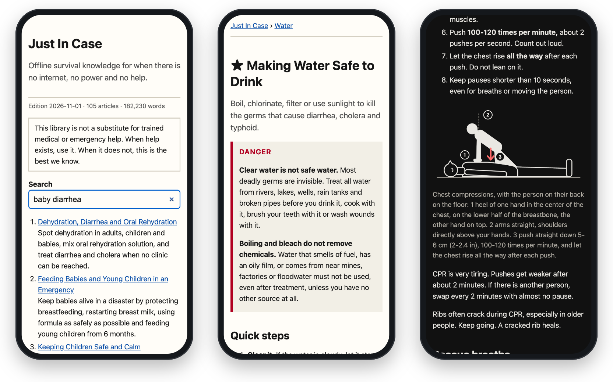

<div align="center">


# Just In Case

**The survival library that still works when nothing else does.**

Clear, sourced, life-saving knowledge for when there is no internet, no power, no shops and no help coming:
water, food, fire, shelter, first aid, sanitation, disasters and rebuilding.

It runs on **paper**, a **Kindle**, an **old phone**, or a **$3 chip on a power bank** that turns into a WiFi library for a whole neighborhood.

[](https://github.com/sudokhaled/just-in-case/actions/workflows/build.yml)
[](https://github.com/sudokhaled/just-in-case/releases/latest)
[](https://sudokhaled.github.io/just-in-case/)
[](LICENSE-CONTENT.txt)
[](LICENSE)

**[Download](../../releases/latest)** · **[Read it online](https://sudokhaled.github.io/just-in-case/)** · **[What's inside](#whats-inside)** · **[Help write it](CONTRIBUTING.md)**



</div>

> [!NOTE]
> **Version 0.1 is a public preview.** Every article is sourced, but most have not yet been checked by an expert. Doctors, nurses, medics, engineers and farmers: [your review](#help-write-it) is the most valuable help you can give.

---

## Why this exists

When the network goes down, the knowledge you need most is exactly the knowledge you can't look up anymore. How much bleach makes 20 liters of water safe? How do you stop bleeding that won't stop? What does a baby with diarrhea need *right now*? Which generator mistake kills a family in their sleep?

This library holds those answers **before** you need them. It is written for a frightened, tired person reading by candlelight on a phone at 5% battery: short sentences, exact numbers, the deadly mistakes first.

## Get it in 5 minutes (do this today)

| You have | Do this | Battery life |
|---|---|---|
| 🖨️ A printer | Print [`just-in-case-core.pdf`](../../releases/latest): the critical articles as a book with page numbers and an index. Add the [pocket cards](../../releases/latest) (`just-in-case-cards.pdf`): cut, laminate, keep in the kitchen and car. [Printing tips](hardware/print/) | forever |
| 📱 A phone | Open the [website](https://sudokhaled.github.io/just-in-case/) once and add it to your home screen: it then works offline like an app. Or save [`just-in-case.html`](../../releases/latest): one file, any browser, with search. | 10–30 h of reading |
| 📖 A Kindle | Copy [`just-in-case.azw3`](../../releases/latest) to it over USB. [Kindle guide](hardware/kindle/) | weeks |
| 📚 Kobo / other e-reader | Copy [`just-in-case.epub`](../../releases/latest). | weeks |
| 🎵 Cheap MP3 player with text mode | Copy the `mp3` folder from [`just-in-case-mp3.zip`](../../releases/latest): one small ASCII file per topic. | days |
| 🔌 An ESP32 board ($2–8) | Turn it into a WiFi library hotspot for everyone nearby: plug it into a computer and click **[Install](https://sudokhaled.github.io/just-in-case/flash/)**. No programming. [ESP32 guide](hardware/esp32/) | 1.5–3 days on a 10,000 mAh power bank |
| 🍓 A Raspberry Pi | The same hotspot, and it can rebuild the library itself. [Pi guide](hardware/raspberry-pi/) | 1–2 days (Pi Zero 2 W) |

Then **share it**. Send the file to your family group chat. Give a printed copy to your neighbor. In a disaster, the people around you matter most. And ⭐ **star this repo** so more people find it before they need it.

## The $3 library hotspot

```
 [power bank] --USB--> [ESP32 chip] ~~~ WiFi ~~~> every phone nearby
   10,000 mAh            ~0.4 W                   "JustInCase-Library"
```

Plug a thumb-sized ESP32 board into a power bank. It creates an open WiFi network called **JustInCase-Library**. Any phone that joins sees the whole library automatically, with no internet, no app and no SIM card, and can **save a complete copy** to keep. One board at a school, clinic, mosque, church or camp can serve a whole community.

Setting one up takes 2 minutes: plug the board into a computer, open the **[installer page](https://sudokhaled.github.io/just-in-case/flash/)** in Chrome or Edge, click Install. [More ways →](hardware/esp32/)

Other devices, including what's even smaller than a Raspberry Pi, are in the [device guide](hardware/).

## What's inside

<!-- BEGIN CONTENTS (generated by tools/build.py --readme) -->
| Category | Articles (★ = critical) |
|---|---|
| **Start Here** | [★ Survival Priorities: What Kills First](content/en/start/survival-priorities.md) · [★ The First 72 Hours After a Disaster](content/en/start/first-72-hours.md) · [Survival Mindset: Controlling Fear and Stress](content/en/start/survival-mindset.md) |
| **Water** | [★ Finding Water](content/en/water/find-water.md) · [★ Making Water Safe to Drink](content/en/water/purify-water.md) · [Storing Water](content/en/water/store-water.md) · [Collecting Rainwater](content/en/water/rainwater.md) · [Building a Sand and Charcoal Filter](content/en/water/sand-filter.md) |
| **Fire and Cooking** | [★ Making and Keeping a Fire](content/en/fire/make-fire.md) · [★ Carbon Monoxide and Smoke: The Silent Killers](content/en/fire/carbon-monoxide.md) · [Cooking Without Power](content/en/fire/cook-without-power.md) · [Fire Without Matches or a Lighter](content/en/fire/fire-without-matches.md) |
| **Shelter and Climate** | [★ Staying Warm in the Cold](content/en/shelter/stay-warm.md) · [★ Surviving Extreme Heat](content/en/shelter/stay-cool.md) · [★ Building an Emergency Shelter](content/en/shelter/emergency-shelter.md) · [Keeping a Home Warm Without Power](content/en/shelter/heat-home-no-power.md) |
| **Living on the Land** | [Choosing Where to Live: Water, Safety and Land](content/en/land/choosing-a-site.md) · [Living in a Forest](content/en/land/forest-living.md) · [Living in a Tropical Rainforest](content/en/land/jungle-living.md) · [Living in the Desert](content/en/land/desert-living.md) · [Living by the Sea](content/en/land/coast-living.md) · [Living by a River or Lake](content/en/land/river-living.md) · [Building a Lasting Home From Natural Materials](content/en/land/build-home.md) · [Clay, Lime, Salt and Fiber: Materials From Nature](content/en/land/natural-materials.md) |
| **Food** | [★ Food Priorities and Rationing](content/en/food/food-rationing.md) · [★ Food Safety Without a Fridge](content/en/food/food-safety.md) · [★ Feeding Babies and Young Children in an Emergency](content/en/food/feeding-babies.md) · [Storing Emergency Food](content/en/food/food-storage.md) · [Preserving Food Without Power](content/en/food/food-preservation.md) · [Foraging Wild Plants Safely](content/en/food/foraging.md) · [Catching Fish](content/en/food/fishing.md) · [Trapping and Preparing Small Game](content/en/food/trapping.md) |
| **Growing Food** | [Growing Food Fast](content/en/farming/grow-food.md) · [When and How to Plant: Seasons, Spacing and Seedlings](content/en/farming/planting-guide.md) · [Fast Crops: Food in 3 Days to 3 Months](content/en/farming/fast-crops.md) · [Calorie Crops That Feed a Family for a Year](content/en/farming/staple-crops.md) · [Soil, Compost and Natural Fertilizer](content/en/farming/soil-compost.md) · [Watering Crops With Little Water](content/en/farming/watering-crops.md) · [Protecting Crops From Pests, Disease and Animals](content/en/farming/crop-pests.md) · [Saving Seeds](content/en/farming/save-seeds.md) · [Harvesting, Drying and Storing Your Crops](content/en/farming/harvest-storage.md) · [Fruit Trees and Perennial Food Plants](content/en/farming/perennial-food.md) |
| **First Aid and Medicine** | [★ First Aid Basics: Check, Call, Care](content/en/medical/first-aid-basics.md) · [★ CPR: When Someone Is Not Breathing](content/en/medical/cpr.md) · [★ Choking](content/en/medical/choking.md) · [★ Stopping Severe Bleeding](content/en/medical/severe-bleeding.md) · [★ Cleaning and Caring for Wounds](content/en/medical/wounds.md) · [★ Burns](content/en/medical/burns.md) · [★ Dehydration, Diarrhea and Oral Rehydration](content/en/medical/dehydration.md) · [★ Hypothermia and Frostbite](content/en/medical/hypothermia-frostbite.md) · [★ Heat Exhaustion and Heat Stroke](content/en/medical/heat-illness.md) · [Moving and Carrying the Injured](content/en/medical/moving-injured.md) · [Broken Bones, Sprains and Dislocations](content/en/medical/fractures-sprains.md) · [Chest and Belly Injuries](content/en/medical/chest-injuries.md) · [Head, Neck and Back Injuries](content/en/medical/head-spine-injury.md) · [Eye Injuries](content/en/medical/eye-injuries.md) · [Pregnancy Care Without a Clinic](content/en/medical/pregnancy-care.md) · [Emergency Childbirth](content/en/medical/childbirth.md) · [Family Planning and Contraception](content/en/medical/contraception.md) · [Severe Allergic Reactions (Anaphylaxis)](content/en/medical/allergic-reactions.md) · [Bites, Stings and Venom](content/en/medical/bites-stings.md) · [Poisoning](content/en/medical/poisoning.md) · [Fever, Infection and Sepsis](content/en/medical/infections-fever.md) · [Malnutrition in Children and Adults](content/en/medical/malnutrition.md) · [Caring for the Sick and Stopping Spread](content/en/medical/infectious-disease.md) · [Diabetes, Asthma, Heart Disease, Epilepsy Without Supplies](content/en/medical/chronic-conditions.md) · [Withdrawal and Running Out of Medicines](content/en/medical/withdrawal.md) · [Medical Kit and Medicines](content/en/medical/medical-kit.md) |
| **Hygiene and Sanitation** | [★ Toilets and Sanitation](content/en/hygiene/sanitation.md) · [★ Handwashing and Personal Hygiene](content/en/hygiene/handwashing.md) · [Menstrual Hygiene](content/en/hygiene/menstrual-hygiene.md) |
| **Disasters** | [★ Earthquakes](content/en/disasters/earthquake.md) · [★ Floods](content/en/disasters/flood.md) · [Hurricanes, Cyclones and Tornadoes](content/en/disasters/storms.md) · [Wildfires and House Fires](content/en/disasters/wildfire.md) · [Tsunamis](content/en/disasters/tsunami.md) · [Nuclear and Radiation Emergencies](content/en/disasters/radiation.md) · [Pandemics and Disease Outbreaks](content/en/disasters/pandemic.md) · [Long Power Outages](content/en/disasters/power-outage.md) · [Surviving Armed Conflict as a Civilian](content/en/disasters/armed-conflict.md) · [Crowds, Crushes and Stampedes](content/en/disasters/crowd-crush.md) |
| **Navigation and Rescue** | [★ Signaling for Rescue](content/en/navigation/signal-rescue.md) · [Navigating Without GPS](content/en/navigation/navigate-no-gps.md) · [What to Do When You Are Lost](content/en/navigation/lost.md) · [Finding and Freeing Trapped People](content/en/navigation/search-rescue.md) · [★ Water and Ice Rescue](content/en/navigation/water-rescue.md) |
| **Communication** | [Emergency Radio](content/en/comms/emergency-radio.md) · [Morse Code and Signal Codes](content/en/comms/morse-code.md) · [Building and Improvising Radios](content/en/comms/build-radio.md) · [Sending and Receiving Morse With What You Have](content/en/comms/morse-devices.md) · [Text Messages Without Internet: Mesh Radios and Phones](content/en/comms/mesh-networks.md) |
| **Power and Light** | [Electricity Without the Grid](content/en/power/off-grid-power.md) · [Batteries: Use, Charge and Stay Safe](content/en/power/batteries.md) · [Light Without Electricity](content/en/power/emergency-lighting.md) |
| **Tools and Skills** | [Essential Knots](content/en/skills/knots.md) |
| **People and Community** | [Psychological First Aid](content/en/community/psychological-first-aid.md) · [Keeping Children Safe and Calm](content/en/community/children-safety.md) · [Elderly, Disabled and Chronically Ill People](content/en/community/vulnerable-people.md) · [Organizing a Community](content/en/community/community-groups.md) · [Staying Safe from Other People](content/en/community/personal-safety.md) |
| **Reference** | [Emergency Kit Checklists](content/en/reference/emergency-kits.md) · [Family Emergency Plan](content/en/reference/family-plan.md) · [Preparing Wisely: Things and Skills That Pay Off Every Day](content/en/reference/everyday-prep.md) · [Measuring Without Tools](content/en/reference/measurements.md) · [What Is Worth the Most When Everything Stops](content/en/reference/most-valuable.md) |

*105 articles, 182,230 words. Full outline and what is still missing: [ROADMAP.md](ROADMAP.md).*
<!-- END CONTENTS -->

Every article follows the same pattern: **the deadly mistakes first, then quick steps you can follow in 30 seconds, then the details, then sources.** Key techniques have simple line drawings, and the 16 most urgent procedures are also printable [pocket cards](content/en/cards.md).

## Principles

1. **Offline forever.** No internet, servers, accounts, trackers or fonts to download. Every edition is a self-contained file.
2. **Runs on anything.** If it can't work on paper, a Kindle and a $3 chip, it doesn't ship.
3. **Exact and sourced.** "Boil for 1 minute", not "boil well". Every article cites WHO, CDC, IFRC, Sphere, military field manuals or peer-reviewed research. Myths are named and corrected.
4. **Danger first, plain words.** Written for panic, darkness and a second language. No jargon, no idioms, no filler.
5. **Free forever.** Content is [CC BY-SA 4.0](LICENSE-CONTENT.txt), code is [MIT](LICENSE). Print it, translate it, sell copies, put it on your own devices. Just keep it open.
6. **Tiny.** The whole library is smaller than one phone photo.

## Questions

**Why not just download Wikipedia?**
Do that too: [Kiwix](https://kiwix.org/) puts all of Wikipedia on a phone. But it takes tens of gigabytes, needs an app, and explains things rather than walking a frightened person through them. This library is about 1 MB, opens on anything, puts the deadly mistakes first and gives exact numbers. The two work well together.

**Can I trust it?**
Every number has a source, listed at the end of its article, mostly from the WHO, IFRC, CDC and similar bodies. But mistakes are possible, and most articles have not yet been reviewed by an expert. Each article shows its review status. When real help exists, use it.

**Does it need the internet, or track me?**
No. Once you have a file, it never connects to anything. There are no ads, accounts, analytics or downloaded fonts. The website works offline after your first visit.

**Can I print it, share it, translate it or sell copies?**
Yes. The content is CC BY-SA 4.0: credit "Just In Case contributors" and keep your version under the same license.

**How many people can one $3 hotspot serve?**
Up to 8 phones at a time, within normal WiFi range. Each visitor can save the whole library (under 500 KB to transfer) and leave, making room for the next. [Hotspot settings](hardware/esp32/).

**Which languages?**
English for now. The build is ready for translations, and each language gets every edition automatically. [Help translate](CONTRIBUTING.md#translating).

## Build it yourself

You need Python 3.8 or newer and nothing else: no packages, no internet. It works on Windows, macOS, Linux and a Raspberry Pi.

```
git clone https://github.com/sudokhaled/just-in-case.git
cd just-in-case
python3 tools/build.py
```

### One library, an edition for every device

Every file is cut from the same articles, sized for its device. Each article has three levels of detail: **full**, **short** (only the warnings and quick steps, about a sixth of the size), or left out. [`tools/editions.ini`](tools/editions.ini) decides, for each device, how much of each article to include, whether to keep the drawings, and a size limit. If an edition grows past its limit, the build cuts it step by step (drawings first, then less critical articles to their short versions) and says exactly what it cut, instead of overflowing the device. The short versions of every article fit in under 60 KB compressed.

The build makes these files (sizes from the last build):

<!-- BEGIN DEVICES (generated by tools/build.py --readme) -->
| Device | File | What it holds | Size |
|---|---|---|---|
| Laptop or desktop; phone or tablet (any browser, saved as one file) | `just-in-case.html` | 105 articles in full, with drawings | 1457 KB |
| Kindle (as AZW3 from the release); Kobo, PocketBook and other e-readers; phone book apps | `just-in-case.epub` | 105 articles in full, with drawings | 475 KB |
| Anything that shows text (UTF-8) | `just-in-case.txt` | 105 articles in full | 1027 KB |
| Tiny screens that need plain ASCII text: the critical articles in full | `just-in-case-core.txt` | 27 articles in full | 260 KB |
| MP3/MP4 players with a text reader; old phones; tiny screens (plus one small file per topic in the mp3 folder) | `just-in-case-mp3.txt` | 105 as warnings and quick steps only | 174 KB |
| Printing the critical articles from any browser | `just-in-case-core.html` | 27 articles in full, with drawings | 381 KB |
| Paper: 16 pocket cards to cut out and laminate | `just-in-case-cards.html` | 16 pocket cards | 32 KB |
| Paper: the whole library as an A4 book with page numbers and an index (make the PDF with weasyprint) | `just-in-case-book.html` | 105 articles in full, with drawings | 1585 KB |
| Paper: the critical articles as an A4 book | `just-in-case-core-book.html` | 27 articles in full, with drawings | 407 KB |
| Paper: an A6 pocket booklet of every article's warnings and quick steps | `just-in-case-pocket.html` | 105 as warnings and quick steps only | 211 KB |
| Raspberry Pi hotspot; any web server; the website, installable as an offline app | `dist/site/` (website) | 105 articles in full, with drawings | 5750 KB |
| ESP32 boards with 4 MB flash (the browser installer uses this) | `hardware/esp32/JustInCase/data/` | 105 articles in full, with drawings | 1540 KB |
| Small boards with about 0.5 MB of file space, such as an ESP8266 with 1 MB flash (ESP-01) | `dist/esp-small/` | 27 articles in full, 78 as warnings and quick steps only | 432 KB |
<!-- END DEVICES -->

The website also has a "Which file for my device?" page with the same table. Useful options:

```
python3 tools/build.py --check              # validate every article (fast)
python3 tools/build.py --only esp-small     # build one edition from editions.ini
python3 tools/build.py --wrap 40            # hard-wrap the text editions for tiny screens
python3 tools/build.py --readme             # refresh the tables in this README
```

## Help write it

This library will only be as good as the people who check it. You can help even if you've never used GitHub:

- **Found a mistake?** [Report it](../../issues/new?template=error-report.yml). A wrong number here could cost a life, so error reports are the most valuable contribution.
- **Medic, nurse, doctor, engineer, farmer, firefighter, soldier, ham radio operator?** Review the articles in your field and [send what you find](../../issues/new?template=expert-review.yml). No GitHub skills needed. Reviewed articles are marked as reviewed, with credit to you.
- **Speak another language?** Translations are the fastest way to reach the people who need this most. [How to translate](CONTRIBUTING.md#translating).
- **Writer?** Pick a 📝 topic from the [roadmap](ROADMAP.md) and follow the [style guide](STYLE_GUIDE.md).
- **Maker?** Test the hotspot on your board and [share how it went](../../discussions), or build a reader for e-paper, Pico W or LoRa: see the [device guide](hardware/).

Start with [CONTRIBUTING.md](CONTRIBUTING.md).

## Disclaimer

This library is not a substitute for trained medical, rescue or emergency help. When help exists, use it. When it doesn't, this is the best knowledge we have, checked against the sources listed in each article. Most articles are still drafts awaiting expert review: each one shows its review status. Just In Case is independent, and is not affiliated with or endorsed by any organization it cites. Read the full [disclaimer](DISCLAIMER.md).

## License

- **Content** (`content/` and all built editions): [Creative Commons BY-SA 4.0](LICENSE-CONTENT.txt). Credit "Just In Case contributors" and keep derivatives under the same license.
- **Code** (`tools/`, `hardware/`, `.github/`): [MIT](LICENSE).
