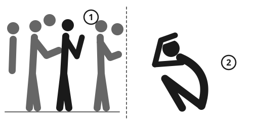

> [!CAUTION]
> **Crowd crushes kill by squeezing, not by trampling.** When too many people are packed together, the pressure stops chests from moving. Many victims die standing up, from lack of air, within minutes.
>
> **If you cannot move your arms freely, or the crowd moves you off your feet, get out now.** Move sideways toward the edge. Do not wait for it to get better.
>
> **Never push toward a gate, stage or exit that is already packed.** The people at the front are being crushed by people behind them who cannot see what is happening.

## Quick steps

1. **Leave early,** as soon as people touch you on all sides and you cannot choose where to walk.
2. **Keep your arms up** in front of your chest, like a boxer, to keep space to breathe.
3. **Stay on your feet,** feet apart, knees a little bent.
4. **Go with the wave,** not against it. After each surge, move diagonally toward the edge.
5. **Save your breath.** Do not scream or push.
6. **Pull up anyone who falls,** at once.
7. **If you fall and cannot get up,** curl on your side, knees up, arms around your head. Get up at the next gap.
8. **Afterwards,** start CPR on anyone who is not breathing normally.

## Why crowd disasters happen

The cause is **density**, not panic. When people are packed tightly, the crowd acts like a liquid. A push at the back travels forward as a wave, and nobody can control where they go.

- People at the front are pressed against a barrier, wall or gate. People at the back keep pushing because they cannot see what is happening.
- The force of many bodies can bend steel barriers. A person caught in the press cannot expand their chest. This is **compressive asphyxia**.
- When someone falls, others fall on top. Those at the bottom cannot breathe.

Studies of crowd disasters at stadiums, festivals, pilgrimages and narrow streets find the same pattern: too many people, a narrow place, and no way out at the front.

## How crowded is too crowded

You cannot count people in a crowd, so use the feel. These numbers are approximate.

| People in 1 square meter (11 sq ft) | What it feels like | Risk |
|---|---|---|
| 1-3 | You walk freely and choose your path | Low |
| 4-5 | People touch you on all sides. You move only at the crowd's speed | Be ready to leave |
| About 6 | You cannot move your arms freely. The crowd moves you | Danger: surges and crush can happen |
| 7 or more | You cannot move at all. Your feet may leave the ground | Deadly |

Safety rules for standing areas at UK sports grounds allow no more than about 4.7 people per square meter. Crowd scientists warn that above about 5 to 6, a moving crowd can turn dangerous quickly.

## Warning signs: leave now

- You cannot move your arms freely.
- The crowd sways in waves. You are moved a step or more without wanting to.
- Your feet are pushed off the ground.
- People shout that they cannot breathe, scream, or climb walls and fences to get out.
- The crowd is moving into a **bottleneck:** a gate, tunnel, alley, bridge, stairs or a slope. Two crowds moving in opposite directions in a narrow place are especially dangerous.
- More people keep arriving, and nobody controls the flow.

## Prevention

- **Know at least 2 ways out.** The way you came in is often the most crowded.
- **Stay near the sides and the back.** Avoid the front, against a stage, barrier or fence.
- **Do not stand in bottlenecks:** gates, stairs, tunnels, narrow streets and slopes.
- **Arrive early and leave late,** or leave early. The most dangerous moments are when everyone moves at once: the end of a match, the last firework, the arrival of a train or an aid truck.
- **Children:** a small child's face is at the height of adults' chests. In a tight crowd, carry them on your shoulders, or better, leave.
- **Agree a meeting point** outside the crowd. See [Keeping Children Safe and Calm](../community/children-safety.md).

## If you are caught in a crush

1. **Stay on your feet,** feet apart, knees a little bent.
2. **Put your arms up** in front of your chest, fists near your chin, like a boxer. This keeps a small space for your lungs.
3. **Do not push against the wave.** No one can stand against a crowd. Let it carry you and stay upright.
4. **Move diagonally.** After each wave there is often a short pause. Use it to step sideways and forward, toward the edge.
5. **Save energy and breath.** Do not scream.
6. **Keep away from walls, barriers and pillars** you could be pressed against.
7. **Do not bend down** to pick up a dropped phone, bag or shoe. That is how people fall.
8. **Help people near you.** If someone falls, pull them up at once, with the people around you.
9. **If you are near the back** and hear screaming ahead, stop moving forward. Shout "Move back!" and pass it on. Tell police or stewards to stop more people coming in.
10. **Climb out if you safely can:** onto a wall or ledge, into a doorway, or up to people who can pull you out.

## If you fall

1. **Try to get up at once.** Get your feet under you and push up.
2. **If you cannot,** lie on your side, knees pulled up to your chest, arms wrapped around your head, elbows forward. This protects your head and chest, and keeps more space for your lungs than lying face down.
3. **Get up at the first gap,** as soon as the pressure eases.

## After a crush

- **Get people into open space** as soon as the pressure is released.
- **Anyone who does not respond and is not breathing normally needs CPR now.** They are dying from lack of air, so rescue breaths matter: give them if you can. See [CPR: When Someone Is Not Breathing](../medical/cpr.md).
- **Use the unhurt people nearby:** 2 helpers for each person who needs CPR, swapping every 2 minutes.
- **If helpers are few and many people are down,** use triage. See [First Aid Basics: Check, Call, Care](../medical/first-aid-basics.md).
- **Survivors** may have a dark red or purple face and neck, tiny red spots and red eyes. They, and anyone with chest pain, trouble breathing, or who passed out, need a medical check. Broken ribs and injuries inside the chest are common. See [Chest and Belly Injuries](../medical/chest-injuries.md).
- **Reunite families** at one clear meeting point for lost children, run by trusted adults. Never let a child leave with someone who has not been checked. See [Keeping Children Safe and Calm](../community/children-safety.md).
- **Many people feel shock, guilt or fear afterwards.** See [Psychological First Aid](../community/psychological-first-aid.md).

## Aid points, borders and evacuation points

People rush when they fear that food, water or a seat on a bus will run out. Good organization prevents crushes.

1. **Tell the truth early:** how much there is, who gets it, when and where. Repeat it in every local language. If there is not enough, say so.
2. **Give out numbered tokens** in advance, house by house or from a list, so people come at set times.
3. **Set up several small points** instead of one big one.
4. **Build lanes** with rope or poles, 1 or 2 people wide. Give shade, water and seats for long waits.
5. **Make separate lines** for women, older people, disabled people and families with small children.
6. **Let people in a few at a time,** and out through a different exit.
7. **Never throw goods from a truck into a crowd,** or suddenly open a gate to a waiting crowd. Both have killed people.
8. **Distribute in daylight,** at fixed times.
9. **Put stewards on a high point** to watch the crowd. If pressure builds, they pause, explain, and restart only when it is calm.

See [Organizing a Community](../community/community-groups.md).

## Common myths

- **"Panic causes crowd disasters."** Too many people in too little space causes them. Most people in a crush stay calm and help each other. Usually nobody can run, so "stampede" is the wrong word.
- **"Pushing back will stop the crush."** It adds pressure and wastes your strength. Move sideways.
- **"Head for the nearest exit."** Everyone else does too. Use a quieter way out, or wait.

## Sources

- Still G.K., *Introduction to Crowd Science*, CRC Press, 2014.
- Sports Grounds Safety Authority, *Guide to Safety at Sports Grounds* (the Green Guide), 6th edition, 2018.
- Helbing D., Johansson A. and Al-Abideen H.Z., "Dynamics of crowd disasters: an empirical study", *Physical Review E*, 2007.
- Helbing D. and Mukerji P., "Crowd disasters as systemic failures: analysis of the Love Parade disaster", *EPJ Data Science*, 2012.
- Taylor P., *The Hillsborough Stadium Disaster: Final Report*, UK Home Office, 1990.
- Drury J., Cocking C. and Reicher S., "Everyone for themselves? A comparative study of crowd solidarity among emergency survivors", *British Journal of Social Psychology*, 2009.
- Sphere Association, *The Sphere Handbook*, 4th edition, 2018.
