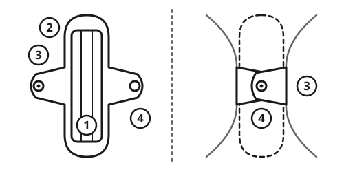

> [!CAUTION]
> **Toxic shock syndrome can kill.** If someone using a tampon or menstrual cup suddenly gets a high fever, vomiting, a rash like sunburn, or dizziness, remove it at once and get medical help urgently.
>
> **Damp cloth pads cause infections.** Dry them completely, in the sun if possible. Never wear a pad that is still damp.
>
> **Soaking a pad every hour, with dizziness or fainting, is an emergency,** especially after a late period. It can be a miscarriage or a pregnancy outside the womb.

## Quick steps

1. **Change** a pad every **4 to 6 hours**, or sooner when it is full. Change a tampon every **4 to 8 hours**.
2. **Wash your hands** with soap before and after changing. See [Handwashing and Personal Hygiene](../hygiene/handwashing.md).
3. **Wash the outside of the genitals** with clean water every day. Do not wash inside the vagina.
4. **Wash cloth pads** in cold water first, then with soap. Rinse well.
5. **Dry them fully in sunlight,** or iron them.
6. **Wrap used disposable pads** and put them in a covered bin. Burn or bury them. Never flush them.

## Making cloth pads

Use **cotton**: old t-shirts, sheets, towels or flannel. Polyester and nylon soak up little. Do not use sand, ash, leaves, newspaper or mud: they cause infection.

### No-sew pad

1. Cut a piece of cotton about **30 x 40 cm (12 x 16 in)**.
2. Fold it into a pad about **8 cm (3 in) wide and 20 to 25 cm (8 to 10 in) long,** at least 4 layers thick.
3. Place it in close-fitting underwear. Hold it with a safety pin at each end.

### Sewn pad with wings

A sewn pad has a **holder** with wings that wrap around the underwear, and a removable **insert** that soaks up blood. The insert dries faster when it is separate.

```
        HOLDER, seen from above

              +------------+
              |            |
              |============|  <- cloth strap
      +-------+            +-------+
      | wing  |   INSERT   | wing  |
      |   o   |   slides   |   o   |
      |       |   under    |       |
      |       |   straps   |       |
      +-------+            +-------+
              |============|  <- cloth strap
              |            |
              +------------+

   o = button or snap. The wings fold under
       the underwear and fasten together.
```



1. **Cut 2 holder pieces** of cotton in this shape: about **24 cm (9.5 in) long**, **8 cm (3 in) wide** in the middle, and **18 cm (7 in)** across the wings.
2. **Sew them together** around the edge. Add a button, snap or safety pin to the wings.
3. **Sew 2 cloth straps** across the holder, near each end.
4. **Make inserts:** fold cotton or towel into a strip about **20 x 7 cm (8 x 3 in)**, 4 to 6 layers thick, and stitch it. Use more layers for heavy days and nights.

Make **at least 4 to 6 pads or inserts,** so some can dry while others are in use.

## Washing and drying cloth pads

1. **Rinse in cold water** first. Hot water fixes blood stains.
2. **Wash with soap,** rubbing until the water runs clear. Rinse well.
3. **Dry completely in direct sunlight.** Sun and heat kill germs.
4. **For privacy,** dry them in the sun under a thin cloth. **Do not hide wet pads** under mattresses, in bags or in dark corners: germs grow in damp cloth.
5. **With no sun,** dry them near a fire, then iron them hot.
6. **Store dry pads** in a clean bag.

Pour the washing water into a latrine or soak pit, away from drinking water. Replace pads that are thin, torn, or smell bad after washing, usually after about a year.

## Menstrual cups

A menstrual cup is a small, soft silicone cup worn inside the vagina to collect blood. One cup lasts for years. Learning to use it often takes 2 or 3 periods.

1. **Wash your hands.** Fold the cup, insert it, and let it open.
2. **Empty it at least every 12 hours.** Pinch the base to release the suction before pulling it out. Do this carefully if you have an IUD.
3. **Rinse it** with safe water and put it back.
4. **At the end of each period, boil it for 5 to 10 minutes,** or as the leaflet says.
5. **Never share a cup.**

## Tampons and toxic shock syndrome

- **Change tampons every 4 to 8 hours.** Never leave one in for more than 8 hours, including at night. Use the lowest absorbency you need.
- **Do not make tampons** from rags, paper, cotton wool or sponges. They can break apart, stay inside and cause infection.

**Toxic shock syndrome (TSS)** is rare, but can kill. Signs come on suddenly: high fever, vomiting or diarrhea, a rash like sunburn, dizziness or fainting, muscle aches, confusion. **Remove the tampon or cup at once and get to a hospital urgently.**

## Disposable pads

1. **Wrap** each used pad in its wrapper or old paper.
2. **Put it in a covered bin.** Shared women's toilets need a bin in each cubicle.
3. **Burn** the contents in a pit or drum, downwind of shelters. Pads contain plastic that makes poisonous smoke: never burn them indoors or on a cooking fire.
4. **Or bury** them deep, at least **30 m (100 ft)** from wells, streams and water points.
5. **Never flush pads:** they block pipes. Avoid pit latrines too: pads fill them faster and make them hard to empty.

## Privacy and safety in camps

Ask women and girls where and how they want toilets, washing places and drying places. Good facilities have:

- separate women's toilets and washrooms that **lock from the inside**
- **light at night,** on the path and inside
- water, soap and a covered bin
- a private place to wash cloths and dry them in the sun

Aid agencies often hand out pads, underwear and soap in "dignity kits". Ask for them. See [Toilets and Sanitation](../hygiene/sanitation.md) and [Staying Safe from Other People](../community/personal-safety.md).

## Period pain

- **Heat:** put a bottle of warm water, wrapped in cloth, on the lower belly or back. Test it on your wrist so it does not burn.
- **Move:** walking and gentle stretching help.
- **Ibuprofen** works well, especially if started when the pain or bleeding begins. Take it with food, at the package dose. Do not take it if you have a stomach ulcer or kidney disease, are pregnant, or if it has made your asthma worse.
- **Paracetamol (acetaminophen)** also helps, at the package dose.

## Heavy bleeding and anemia

Periods usually come every **21 to 35 days** and last **2 to 7 days**. Bleeding is heavy if you soak a pad every 1 to 2 hours for several hours, must change at night, pass clots larger than **2.5 cm (1 in)**, or bleed for more than 7 days.

Heavy periods month after month cause **anemia** (too little blood). Signs: tiredness, breathlessness when walking, a fast heartbeat, dizziness, and pale skin, gums and inner eyelids. Eat foods with iron: meat, fish, eggs, beans, lentils and dark green leaves. Take iron tablets at the package dose if you have them.

## Missed or late periods

Stress, fear, illness, hunger, weight loss and very hard work can all stop periods. So can pregnancy, breastfeeding, some contraceptives (injectable, implant, hormonal IUD) and menopause, usually from about 45 to 55. Periods usually return when food and safety improve.

**Periods that stop do not protect against pregnancy:** an egg is released before the next period. If pregnancy is possible, take a urine pregnancy test. See [Pregnancy Care Without a Clinic](../medical/pregnancy-care.md) and [Family Planning and Contraception](../medical/contraception.md).

## A girl's first period

First periods usually start between ages **10 and 15**. Explain before it happens. Any trusted adult can do this, including a father.

- Periods are normal and healthy. Period blood is ordinary blood and tissue, not dirt, illness or injury. Washing and bathing during a period are healthy.
- Each month the womb grows a soft lining. If there is no pregnancy, it comes out as blood for a few days.
- Periods are often irregular in the first 1 to 2 years.
- Once periods start, sex can lead to pregnancy.
- Show her how to use and wash a pad. Give her pads, clean underwear and a bag.

Families and faiths have their own customs around periods. Sending a girl or woman to sleep alone outside or in a hut has caused deaths from cold, smoke, snakebite and attack. In a crisis, keep her safe and close to others.

## Men and boys

- Learn the basics, so you can help daughters, sisters and partners without shame.
- Include pads, soap and underwear when you buy or ask for supplies.
- Help build private, lockable toilets and drying places.
- Never mock anyone for having a period. Teach boys the same.

## When to get help

- Signs of toxic shock syndrome, or soaking a pad every hour with dizziness or fainting: go to a hospital now.
- Severe belly pain, especially with a late period: go now.
- Fever, a bad-smelling or colored discharge, itching or sores.
- Bleeding between periods or after sex, pain that stops daily life, or no period for 3 months without pregnancy or breastfeeding.
- No period at all by age 15.

## Sources

- UNICEF, *Guidance on Menstrual Health and Hygiene*, 2019.
- Columbia University Mailman School of Public Health and International Rescue Committee (IRC), *A Toolkit for Integrating Menstrual Hygiene Management (MHM) into Humanitarian Response*, 2017.
- Sphere Association, *The Sphere Handbook: Humanitarian Charter and Minimum Standards in Humanitarian Response*, 2018.
- van Eijk A.M. et al., "Menstrual cup use, leakage, acceptability, safety, and availability: a systematic review and meta-analysis", *The Lancet Public Health*, 2019.
- American College of Obstetricians and Gynecologists (ACOG), *Menstruation in Girls and Adolescents: Using the Menstrual Cycle as a Vital Sign*, Committee Opinion 651, 2015.
- National Institute for Health and Care Excellence (NICE), *Heavy Menstrual Bleeding: Assessment and Management*, NG88, 2018.
