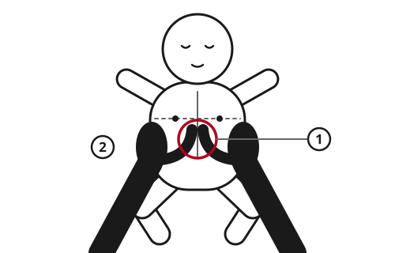

> [!CAUTION]
> **Gasping is not breathing.** If a person does not respond and is not breathing normally, start CPR at once. Slow, noisy, occasional gasps are common in the first minutes after the heart stops. They are a sign of dying, not of life.
>
> **Push hard and fast, and do not stop.** Every pause lets the blood stop moving. Soft or slow pushes do almost nothing. You cannot make things worse: without CPR, a person whose heart has stopped will die.

## Quick steps (adults)

1. **Check for danger,** then tap the shoulders and shout. No response?
2. **Open the airway:** tilt the head back and lift the chin. Look for normal breathing for up to 10 seconds.
3. **Not breathing normally?** Call 112, 911 or your local number. Put the phone on speaker. Send someone to find a defibrillator (AED).
4. **Kneel beside the chest.** Put the heel of one hand in the center of the chest, on the lower half of the breastbone. Put your other hand on top.
5. **Push straight down 5-6 cm (2-2.4 in), 100-120 times per minute.** Let the chest come all the way back up after each push.
6. **If you are trained and willing,** give 2 rescue breaths after every 30 pushes. If not, keep pushing without stopping.
7. **When the AED arrives,** switch it on and do what it says.
8. **Keep going** until the person wakes up or breathes normally, trained help takes over, or you cannot go on.

## Is the heart stopped?

Start CPR if the person **does not respond** and is **not breathing normally**. Do not waste time feeling for a pulse. Even doctors often get this wrong.

- **Agonal breathing** looks like slow, deep gasps, snorts or gurgles, with long gaps. It is not normal breathing. Start CPR.
- When the heart stops, the person may jerk for a few seconds, like a short seizure. Afterwards, check breathing.
- **If you are not sure, start CPR.** CPR on a person whose heart is still beating rarely causes serious harm.

## Chest compressions

1. Lay the person on their back on a firm surface. The floor is best. A soft bed absorbs the pushes.
2. Kneel at the side of the chest.
3. Place the heel of one hand in the center of the chest. Put the other hand on top and lock your fingers.
4. Keep your arms straight, with your shoulders directly above your hands.
5. Push straight down **5-6 cm (2-2.4 in)** using your body weight, not your arm muscles.
6. Push **100-120 times per minute,** about 2 pushes per second. Count out loud.
7. Let the chest rise **all the way** after each push. Do not lean on it.
8. Keep pauses shorter than 10 seconds, even for breaths or moving the person.

CPR is very tiring. Pushes get weaker after about 2 minutes. If there is another person, swap every 2 minutes with almost no pause.

Ribs often crack during CPR, especially in older people. Keep going. A cracked rib heals.

## Rescue breaths

Breaths add oxygen. For a sudden collapse in an adult, compressions alone work well for the first minutes. Breaths matter much more when the cause was lack of oxygen: **drowning, choking, smoke, drug overdose,** and in **children and babies.**

1. After 30 compressions, tilt the head back and lift the chin.
2. Pinch the soft part of the nose closed.
3. Seal your mouth over their mouth. Blow steadily for about 1 second, just enough to make the chest rise.
4. Let the chest fall, then give a second breath.
5. Go back to compressions at once. If the chest did not rise, check the mouth and the head tilt next time. Do not try more than 2 breaths each round.

If you are not trained or cannot give breaths, do compressions only. That is far better than nothing.

## Children and babies

A child is from 1 year old until puberty. A baby (infant) is under 1 year. For newborns, see [Emergency Childbirth](../medical/childbirth.md).

Children and babies usually stop breathing first, and the heart stops later from lack of oxygen. So breaths come first.

1. **Open the airway.** For a child, tilt the head back and lift the chin. For a baby, keep the head level (face pointing straight up), and lift the chin.
2. **Give 5 rescue breaths.** For a child, pinch the nose and cover the mouth. For a baby, cover both the mouth and nose with your mouth. Use gentle puffs, just enough to make the chest rise.
3. **Start compressions** on the lower half of the breastbone.
4. **Continue with 15 compressions to 2 breaths** if you were trained in child CPR. If not, use 30 to 2, as for adults.
5. **If you are alone with no phone,** do 1 minute of CPR, then go for help. If you have a phone, call on speaker right away.

| Who | Hand position | Depth | Rate |
|---|---|---|---|
| Adult | 2 hands, center of chest | 5-6 cm (2-2.4 in) | 100-120 per minute |
| Child (1 year to puberty) | Heel of 1 or 2 hands | At least one-third of chest depth, about 5 cm (2 in) | 100-120 per minute |
| Baby (under 1 year) | 2 thumbs side by side, hands around the chest. If your hands cannot reach around, the heel of 1 hand | At least one-third of chest depth, about 4 cm (1.5 in) | 100-120 per minute |

## Drowning

1. Get the person out of the water without going in yourself, if you can. Reach, throw something that floats, or use a boat. See [Water and Ice Rescue](../navigation/water-rescue.md).
2. If they are not breathing normally, give **5 rescue breaths** first.
3. Then do 30 compressions and 2 breaths.
4. Do not try to push water out of the lungs. It wastes time.
5. They will often vomit. Roll them onto their side, clear the mouth, roll them back and continue.

After cold-water drowning, keep going longer. Cold can protect the brain. See [Hypothermia and Frostbite](../medical/hypothermia-frostbite.md).

## Using a defibrillator (AED)

An AED is a box that gives an electric shock to a heart that is quivering instead of pumping. It is often the only thing that can restart an adult's heart. Anyone can use one. It only shocks if it detects a rhythm that needs a shock.

1. Switch it on. Follow the voice and pictures.
2. Bare the chest. Cut or tear clothes if needed. Wipe the chest dry.
3. Stick one pad below the right collarbone. Stick the other on the left side of the chest, below the armpit. Keep doing compressions while someone else places the pads.
4. When the AED says it is analyzing, **no one touches the person.**
5. If it says shock, make sure no one is touching, then press the shock button (some AEDs shock on their own).
6. **Start compressions again immediately** after the shock. Leave the pads on and follow the AED's prompts every 2 minutes.

- **Children under 8 years or under 25 kg (55 lb):** use child pads or the child setting if there is one. If not, use adult pads. If the pads would touch each other, put one in the center of the chest and one in the middle of the back.
- Remove medicine patches from the chest. Do not put a pad over a lump under the skin from a pacemaker.
- Move the person out of puddles. Water on the chest weakens the shock.

## Special situations

- **Pregnancy:** if the belly is clearly large, a second person pushes it gently towards the woman's left side during CPR. This helps blood flow back to her heart.
- **Drug overdose (opioids):** if you have naloxone, give it as the package says. Keep doing CPR.
- **Electric shock:** turn off the power before you touch the person.
- **Lightning:** it is safe to touch the person. CPR often works after lightning. If several people were struck, help those who are not breathing first.

## When to stop

Stop CPR only when:

- the person **wakes up,** moves, opens their eyes, or **breathes normally.** Put them in the recovery position and keep checking breathing. Be ready to start again. See [First Aid Basics: Check, Call, Care](../medical/first-aid-basics.md).
- trained help takes over.
- you are too exhausted to continue.
- the place becomes dangerous for you.

> [!NOTE]
> **The honest truth.** In adults whose heart stopped suddenly, CPR alone rarely restarts the heart. It keeps some blood and oxygen moving to the brain until a defibrillator and a hospital can do the rest. Without them, survival is uncommon.
>
> CPR works more often when the cause was lack of oxygen (drowning, choking, smoke), in children, after lightning, and when CPR started within seconds of the collapse.
>
> **When no defibrillator and no help can come,** and there has been no sign of life after 20 to 30 minutes of good CPR, survival is very unlikely. It is reasonable and right to stop. You gave this person every chance they had. Cold-water drowning and very cold people are an exception: keep going longer if you can.

Doing CPR, and losing the person, is painful for everyone who was there. Talk about it with people you trust. See [Psychological First Aid](../community/psychological-first-aid.md).

## Common mistakes

- **Pushing too softly.** 5 cm (2 in) is deeper than most people expect. Push hard.
- **Not letting the chest rise.** Leaning on the chest stops the heart from refilling.
- **Long pauses** to check for a pulse, to give breaths, or to talk.
- **Doing CPR on a soft bed.** Move the person to the floor.
- **Stopping because of fear.** You will not hurt someone whose heart has stopped. Without CPR they will die.
- **Mistaking gasps for breathing.** Gasping means start CPR.

## Sources

- European Resuscitation Council (ERC), *European Resuscitation Council Guidelines 2021: Basic Life Support*, 2021.
- European Resuscitation Council (ERC), *European Resuscitation Council Guidelines 2021: Paediatric Life Support*, 2021.
- European Resuscitation Council (ERC), *European Resuscitation Council Guidelines 2021: Cardiac Arrest in Special Circumstances*, 2021.
- American Heart Association (AHA), *2020 American Heart Association Guidelines for Cardiopulmonary Resuscitation and Emergency Cardiovascular Care*, 2020.
- American Heart Association (AHA), *2025 American Heart Association Guidelines for Cardiopulmonary Resuscitation and Emergency Cardiovascular Care*, 2025 (infant compression technique).
- International Liaison Committee on Resuscitation (ILCOR), *International Consensus on Cardiopulmonary Resuscitation and Emergency Cardiovascular Care Science with Treatment Recommendations*, 2020.
- International Federation of Red Cross and Red Crescent Societies (IFRC), *International First Aid, Resuscitation, and Education Guidelines 2020*, 2020.
