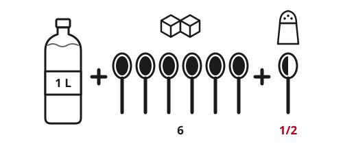

> [!CAUTION]
> **Diarrhea kills by drying out the body.** A baby, or anyone with cholera, can die within hours. Start oral rehydration solution (ORS) at the first loose stool. Do not wait.
>
> **Measure exactly.** Too much salt in home-made ORS can poison a child. Too much sugar makes diarrhea worse.
>
> **Never give anti-diarrhea medicine (such as loperamide) to children,** or to anyone with blood in the stool or a high fever.

## Quick steps

1. **Give ORS** after every loose stool. Use a packet of oral rehydration salts, or mix **1 liter (1 quart) of clean water + 6 level teaspoons of sugar + 1/2 level teaspoon of salt.**
2. **Give it slowly:** small sips from a cup, or **1 teaspoon every 1-2 minutes** for a small child.
3. **If they vomit, wait 10 minutes,** then start again, more slowly.
4. **Keep breastfeeding and keep eating.** Do not stop food.
5. **Give zinc** to children for 10-14 days, if you have it.
6. **Get help at once** for danger signs: blood in the stool, cannot drink, very sleepy, sunken eyes, or a baby with no urine for 6 hours.

## How dehydrated are they?

If a person has **2 or more** signs in a column, treat them as that level.

| Sign | Some dehydration | Severe dehydration |
|---|---|---|
| Alertness | Restless, irritable | Very sleepy, floppy, hard to wake, or unconscious |
| Eyes | Sunken | Sunken |
| Drinking | Thirsty, drinks eagerly | Drinks poorly or cannot drink |
| Skin pinch | Goes back slowly | Goes back very slowly (more than 2 seconds) |
| Urine | Less, dark yellow | Very little or none |
| Action | Extra ORS at home (below) | Emergency: needs a health worker and usually a drip (IV) |

**Skin pinch:** pinch the skin of the belly halfway between the navel and the side. Hold for 1 second, then let go. This test is less reliable in old people, very thin people and fat people.

**Babies:** also look for a sunken soft spot on top of the head, no tears when crying, a dry mouth, and fewer wet diapers. **No urine for 6 hours or more is a danger sign.**

**Adults:** look for thirst, dark urine, dry mouth, headache, and dizziness when standing up. Confusion, fainting, cold hands and feet, a fast weak pulse or no urine mean severe dehydration.

## Making ORS

### ORS packets (best)

Packets of oral rehydration salts are the best choice. They are cheap, and health services often give them free. Mix one packet with **exactly** the amount of clean water printed on it. Many packets are for 1 liter, but some are for 200 mL or 500 mL. Do not add sugar.

### Home-made ORS

1. Measure **1 liter (about 4 cups) of safe water:** boiled and cooled, or treated. See [Making Water Safe to Drink](../water/purify-water.md).
2. Add **6 level teaspoons of sugar.** Level means flat on top, not heaped.
3. Add **1/2 level teaspoon of salt.**
4. Stir until it dissolves.
5. **Taste it.** It must taste **no saltier than tears.** If it is saltier, throw it away and make it again.

A level teaspoon is 5 mL. Kitchen spoons vary, so use a measuring spoon if you have one. A 1-liter drink bottle measures the water.

ORS works because sugar and salt in the right balance pull water from the gut into the body. Too much salt can cause fits in a baby. Too much sugar pulls water into the gut and makes diarrhea worse.

- Make it fresh every day. Throw away what is left after **24 hours.**
- Keep it covered. Do not boil it after mixing: boiling makes it too strong.

> [!NOTE]
> If you have no ORS, sugar or salt, give other safe fluids: soup with a little salt, salted rice water, yogurt drinks, coconut water, breast milk or plain safe water. These help prevent dehydration, but they do not treat it as well as ORS.

## How much to give

### To prevent dehydration (no signs yet)

| Age | After each loose stool |
|---|---|
| Under 2 years | 50-100 mL (1/4 to 1/2 cup) |
| 2 to 10 years | 100-200 mL (1/2 to 1 cup) |
| Over 10 years and adults | As much as they want |

A cup here means 250 mL (8 fl oz).

### For some dehydration

Give about **75 mL of ORS per kg of body weight over 4 hours.** If you do not know the weight, use the age.

| Age (weight) | ORS over the first 4 hours |
|---|---|
| Under 4 months (under 5 kg) | 200-400 mL |
| 4-11 months (5-8 kg) | 400-600 mL |
| 12-23 months (8-11 kg) | 600-800 mL |
| 2-4 years (11-16 kg) | 800-1,200 mL |
| 5-14 years (16-30 kg) | 1,200-2,200 mL |
| 15 years or older (over 30 kg) | 2,200-4,000 mL |

1. Give it in small sips. Give more if they want more.
2. Keep breastfeeding between sips.
3. If the eyelids become puffy, stop ORS. Give plain water or breast milk, then restart ORS when the puffiness is gone.
4. After 4 hours, check the signs again. Better: go back to the prevention amounts. Same: repeat the 4 hours. Worse: treat it as severe.

### If they vomit

Vomiting usually settles once rehydration starts. Wait 10 minutes, then give 1 teaspoon or 1 sip every 1-2 minutes. Slowly increase the amount.

## Keep feeding

- **Breastfeed more often and for longer.** Breast milk is the best food and drink for a sick baby.
- Babies not breastfed: keep giving their usual milk or formula at normal strength, plus ORS.
- Children over 6 months and adults: keep eating normal food in small, frequent meals. Porridge, rice, lentils, potatoes, bananas, eggs and meat are good, with a little oil.
- After the diarrhea stops, give a child **one extra meal each day for 2 weeks.**

For feeding young children in a crisis, see [Feeding Babies and Young Children in an Emergency](../food/feeding-babies.md).

## Zinc for children

Zinc shortens diarrhea and makes it less likely to return. The World Health Organization (WHO) recommends it for children with diarrhea:

- **Under 6 months: 10 mg once a day.**
- **6 months and older: 20 mg once a day.**
- Give it for **10-14 days,** even after the diarrhea stops.

Zinc tablets for children dissolve in a spoon of breast milk or clean water.

## Cholera

Cholera causes sudden, huge amounts of watery stool that look like the water rice was washed in ("rice-water stools"). Vomiting is common. There is often no fever. **Cholera can kill a healthy adult within hours.**

1. **Start ORS at once and give a lot.** An adult with severe cholera can lose a liter (quart) or more of fluid per hour. Give at least as much ORS as comes out in stool and vomit, and more.
2. **Get to a cholera treatment center** if one exists. Severe cases need a drip (IV). Keep giving ORS on the way.
3. **Tell health authorities.** One case can mean an outbreak is starting.
4. **Protect everyone else.** See [Caring for the Sick and Stopping Spread](../medical/infectious-disease.md).

WHO says up to 80% of cholera cases can be treated with ORS alone.

## When no help can come for days

- **Keep a written record:** each stool, each vomit, each cup of ORS, each time they pass urine.
- **Check the signs in the table every 1-4 hours.**
- **Watch the urine.** Passing pale urine every few hours is a good sign.
- **Severe dehydration with no drip:** if they can still swallow, give **about 20 mL of ORS per kg of body weight each hour for 6 hours,** in constant small sips. For a 10 kg child that is 200 mL an hour. For a 60 kg adult it is 1.2 liters an hour. Check the signs every hour.
- **If they cannot swallow or are unconscious,** do not pour fluid into the mouth: they can choke. Lay them on their side and evacuate at any cost.
- **Severely malnourished children** (very thin, or swollen feet) need ORS given more slowly, and a health worker soon. Normal amounts can overload their heart. See [Malnutrition in Children and Adults](../medical/malnutrition.md).

## When to get help

Get a health worker urgently, or evacuate, if there is:

- Blood in the stool.
- Inability to drink or breastfeed, or vomiting of everything.
- Severe dehydration signs: very sleepy, floppy, sunken eyes, very slow skin pinch.
- No urine for 6 hours in a baby, or almost no urine all day in an older child or adult.
- High fever, fits (convulsions), or a swollen, hard or very painful belly.
- Diarrhea for **14 days or more.**
- Severe watery diarrhea in a place with cholera.

## Common mistakes and myths

- **"Stop drinking, or stop eating, so the diarrhea stops."** Wrong and deadly. Fluids and food replace what is lost.
- **Sports drinks, soda, fruit juice and sweet tea are not ORS.** They have too much sugar and too little salt, and can make diarrhea worse.
- **Anti-diarrhea medicines never replace fluids.** Never give them to children, or with blood in the stool, fever or cholera. Adults with plain watery diarrhea may use them as the package says.
- **Antibiotics do not help most diarrhea,** which is caused by viruses. A health worker may give them for bloody diarrhea or severe cholera.

## Preventing diarrhea

Treat drinking water, wash hands with soap, use a safe toilet, keep food clean and breastfeed babies. Vaccines against rotavirus, measles and cholera prevent many deaths. See [Handwashing and Personal Hygiene](../hygiene/handwashing.md), [Toilets and Sanitation](../hygiene/sanitation.md) and [Food Safety Without a Fridge](../food/food-safety.md).

## Sources

- World Health Organization (WHO), *The Treatment of Diarrhoea: A Manual for Physicians and Other Senior Health Workers*, 4th revision, 2005.
- WHO and UNICEF, *Clinical Management of Acute Diarrhoea: WHO/UNICEF Joint Statement*, 2004.
- WHO, *Integrated Management of Childhood Illness (IMCI) Chart Booklet*, 2014.
- WHO, *Pocket Book of Hospital Care for Children*, 2nd edition, 2013.
- WHO, *Cholera* (fact sheet), 2023.
- Global Task Force on Cholera Control (GTFCC), *Cholera Outbreak Response: Field Manual*, 2019.
