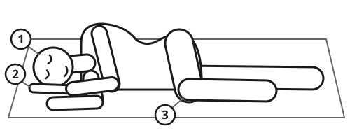

> [!CAUTION]
> **Do not become a second victim.** Before you go close, look for traffic, fire, smoke, gas, electricity, deep or fast water, falling walls and violence. If it is not safe, stay back and call for help.
>
> **Heavy bleeding comes first.** A person can bleed to death in a few minutes. If blood is spurting, flowing or pooling, press hard on the wound before you do anything else.
>
> **A person who does not respond and is not breathing normally needs CPR now.** Slow, noisy gasps are not normal breathing.

## Quick steps

1. **Check for danger.** Make the area safe for yourself first, then for the injured person.
2. **Check for a response.** Tap both shoulders and shout: "Can you hear me? Open your eyes!"
3. **Stop heavy bleeding.** Look quickly from head to feet. Press hard on any wound that spurts, flows or pools. See [Stopping Severe Bleeding](../medical/severe-bleeding.md).
4. **Open the airway.** If they do not respond, tilt the head back and lift the chin.
5. **Check breathing** for up to 10 seconds. Look at the chest, listen, and feel for breath on your cheek.
   - **Not breathing normally:** call for help and start CPR. See [CPR: When Someone Is Not Breathing](../medical/cpr.md).
   - **Breathing normally:** put them on their side in the recovery position: top knee bent, head tilted back, mouth pointing down.
6. **Call for help.** Call emergency services, or send someone. Say where you are first.
7. **Care until help comes.** Keep them lying down, warm and calm. Check breathing, pulse and response every 5 minutes. Write down what you find and the time.

## Check the scene

- **Traffic:** stop well behind a crash, turn on hazard lights, and send someone to warn drivers.
- **Electricity:** do not touch the person until the power is off. Stay at least 10 m (33 ft) from fallen power lines, and at least 18 m (20 yards) from large high-voltage lines on tall towers.
- **Fire, smoke or gas:** do not go in. Do not use flames or light switches near gas.
- **Water:** reach with a pole or throw something that floats. Do not swim out to a panicking person unless you are trained. See [Water and Ice Rescue](../navigation/water-rescue.md).
- **Damaged buildings:** walls can fall in aftershocks. Do not enter a building that is badly cracked or leaning.
- **Several people down for no clear reason:** suspect poison gas, such as carbon monoxide. Do not go in.

Move an injured person only if they are in danger. Drag them by the clothes at the shoulders, along the length of the body. See [Moving and Carrying the Injured](../medical/moving-injured.md).

## Protect yourself

Blood can carry hepatitis B, hepatitis C and HIV.

- Wear disposable gloves. If you have none, put plastic bags over your hands, or use a thick cloth as a barrier.
- Cover cuts on your own hands. Use a face shield for rescue breaths if you have one. Wash your hands with soap afterwards.
- If blood gets into your eyes, mouth or a cut, rinse at once with lots of clean water. Where HIV is common, medicine to prevent infection (post-exposure prophylaxis) must start as soon as possible, and no later than **72 hours** after.

**Do not let a lack of gloves stop you from saving a life.** Severe bleeding cannot wait.

## Find what kills first

Check in this order: **Danger, Response, heavy Bleeding, Airway, Breathing, Circulation** (shock). Fix each problem before you move to the next.

### How awake are they?

Write down the level and the time. A person who becomes less alert over time is in danger.

- **Alert:** eyes open, talks, knows who and where they are.
- **Voice:** responds only when you speak loudly.
- **Pain:** responds only when you squeeze the muscle at the top of the shoulder hard.
- **Unresponsive:** no response at all.

### Open the airway

In an unconscious person, the tongue can fall back and block the throat.

1. Lay them on their back.
2. Put one hand on the forehead and gently tilt the head back.
3. Put two fingertips under the bony point of the chin and lift it.
4. Look in the mouth. Remove only things you can see and grab easily.
5. Keep the airway open and check breathing for up to 10 seconds. Normal breathing is regular and quiet. Occasional gasps, gurgling, or snoring that stops are not normal: start CPR.

Opening the airway comes before worries about a neck injury. A person can live with a neck injury, but not without air. See [Head, Neck and Back Injuries](../medical/head-spine-injury.md).

## Call for help

- **112** works from mobile phones in Europe and many other countries. **911** is used in North America, **999** in the UK. Learn your local number now.
- Put the phone on speaker so you can keep helping while you talk.
- Say where you are first, then what happened, how many people are hurt, whether they are breathing and bleeding, and your phone number.
- Do not hang up until the call-taker tells you to. They can guide you.
- **No signal:** a text message may get through when a call cannot. Move to higher ground. Send 2 people together with a written note: place, time, number hurt and their injuries. See [Signaling for Rescue](../navigation/signal-rescue.md).

## The recovery position

Use it for a person who is breathing normally but does not respond, or is very drowsy. It keeps the airway open and lets vomit drain out.

1. Kneel beside them. Remove glasses and bulky things from their pockets.
2. Straighten both their legs.
3. Place the arm nearest you out at a right angle to the body, elbow bent, palm up.
4. Bring the far arm across the chest. Hold the back of that hand against the cheek nearest you.
5. With your other hand, pull the far knee up so the foot stays flat on the ground.
6. Keep their hand pressed to their cheek. Pull the far knee towards you to roll them onto their side, facing you.
7. Bend the top leg so the hip and knee are at right angles. This stops them rolling onto the face.
8. Tilt the head back a little, with the mouth pointing slightly down.
9. Check their breathing every minute. If it stops, roll them onto their back and start CPR.
10. After 30 minutes, turn them onto the other side to protect the lower arm.

If the neck or back may be injured, still use this position if they vomit or you must leave them. Roll them slowly, keeping the head, neck and body in a straight line.

## Shock

Shock means the body is not getting enough blood. It is caused by bleeding (outside or inside), burns, severe vomiting or diarrhea, severe infection or a severe allergic reaction.

**Signs:** pale or grey, cold, sweaty skin; fast, weak pulse; fast, shallow breathing; thirst, worry, confusion, then drowsiness; dizziness or fainting when they sit up.

1. **Treat the cause.** Stop bleeding. For a severe allergic reaction, use the adrenaline (epinephrine) injector.
2. **Lay them flat on their back.** Do not let them sit up, stand or walk.
3. If there is no injury to the legs, hips, back or head, you may raise and support their legs on a bag or folded blanket.
4. **Keep them warm.** Put insulation under them as well as on top. Cold ground steals heat fast.
5. Loosen tight clothing at the neck, chest and waist.
6. **Give nothing to eat or drink** if help will arrive within a few hours. Wet their lips if they are thirsty.
7. Check breathing, pulse and response every 5 minutes. If they stop responding but still breathe, use the recovery position.

> [!NOTE]
> **When help is days away:** if the person is fully awake, can swallow and is not vomiting, give small sips of oral rehydration solution or clean water often. With a belly wound, give only small sips, and stop if they vomit or the belly swells (see [Chest and Belly Injuries](../medical/chest-injuries.md)). See [Dehydration, Diarrhea and Oral Rehydration](../medical/dehydration.md).

## Vital signs

Write them down with the time. Repeat every 5 to 15 minutes. The change over time matters more than one number.

- **Pulse:** press 2 fingers (not your thumb) on the thumb side of the inside wrist, or on the side of the neck next to the windpipe. In a baby, use the inside of the upper arm. Count for 30 seconds and multiply by 2.
- **Breathing:** count chest rises for 30 seconds and multiply by 2. Count babies for a full 60 seconds, because their breathing is irregular.
- **Temperature:** normal is about 37°C (98.6°F). 38°C (100.4°F) or higher is a fever. Below 35°C (95°F) is hypothermia.

| Age | Pulse at rest (per minute) | Breathing at rest (per minute) |
|---|---|---|
| Baby under 1 year | 100-160 | 30-60 |
| Child 1-5 years | 80-140 | 20-40 |
| Child 6-12 years | 70-120 | 18-30 |
| Teenager and adult | 60-100 | 12-20 |

These ranges are approximate. **Danger signs:** an injured adult breathing faster than 30 per minute, or a pulse that keeps rising. The World Health Organization counts these as fast breathing in a child with cough or fever: **60 or more** per minute under 2 months, **50 or more** at 2-12 months, **40 or more** at 1-5 years.

## Triage: when many people are hurt

This simple method is based on the START system used by rescuers.

1. **Shout:** "If you can walk, come to me." People who can walk can wait. Ask them to help.
2. **Go to those who cannot walk.** Spend less than 1 minute on each person.
3. **Not breathing?** Open the airway once. If they start breathing, put them in the recovery position. If they still do not breathe, move on.
4. **Breathing?** They are **urgent** if they breathe faster than 30 per minute, have no pulse at the wrist, or cannot follow a simple command such as "squeeze my hand". Stop heavy bleeding and roll unconscious people onto their side before moving on.
5. **Mark each person** you have checked, for example with a strip of cloth or a pen mark on the forehead.
6. **Go back and check everyone again.** People get worse or better.

> [!NOTE]
> This is the hardest part of first aid. With many injured and few helpers, doing CPR on one person can cost the lives of several others who could be saved. Moving on is the right decision. It is not your fault.

## When to get help

Call emergency services, or start evacuation at once, for anyone who:

- does not respond, or is getting more drowsy or confused
- is not breathing normally, or struggles to breathe
- has bleeding you cannot stop, or signs of shock
- has chest pain or pressure lasting more than a few minutes
- has a drooping face, a weak arm, or slurred speech (signs of a stroke)
- has a first seizure (fit), or one lasting more than 5 minutes See [Diabetes, Asthma, Heart Disease, Epilepsy Without Supplies](../medical/chronic-conditions.md).
- has a serious head injury, a serious burn, or a broken thigh bone or pelvis
- had a severe allergic reaction, even if adrenaline helped

For choking, see [Choking](../medical/choking.md).

## Sources

- International Federation of Red Cross and Red Crescent Societies (IFRC), *International First Aid, Resuscitation, and Education Guidelines 2020*, 2020.
- European Resuscitation Council (ERC), *European Resuscitation Council Guidelines 2021: First Aid*, 2021.
- American Heart Association and American Red Cross, *2020 American Heart Association and American Red Cross Guidelines for First Aid*, 2020.
- Fleming S. et al., "Normal ranges of heart rate and respiratory rate in children from birth to 18 years of age", *The Lancet*, 2011.
- World Health Organization (WHO), *Integrated Management of Childhood Illness: Chart Booklet*, 2014.
- Benson M., Koenig K.L., Schultz C.H., "Disaster triage: START, then SAVE", *Prehospital and Disaster Medicine*, 1996.
- World Health Organization (WHO), *Guidelines on Post-Exposure Prophylaxis for HIV*, 2014.
- Werner D. et al., *Where There Is No Doctor*, Hesperian Health Guides (further reading).
