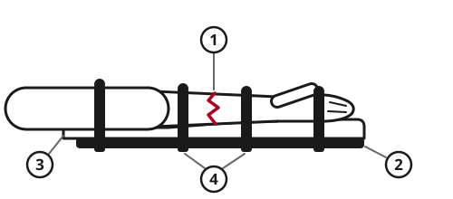
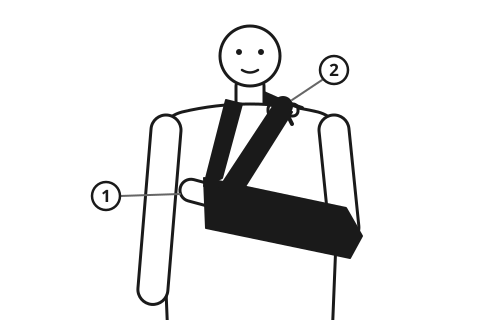

> [!CAUTION]
> **A broken thigh bone or pelvis can kill by bleeding inside the body.** Keep the person still, lying down and warm, and evacuate urgently.
>
> **Check blood flow beyond the injury before and after splinting.** Cold, pale or blue fingers or toes, or new numbness, mean the splint is too tight or the limb is losing its blood supply.
>
> **Do not push a bone back into a wound.** Cover it and splint it as it is.

## Quick steps

1. **Stop any heavy bleeding first.** See [Stopping Severe Bleeding](../medical/severe-bleeding.md).
2. **Keep the injured part still.** Tell the person not to move it.
3. **Check blood flow and feeling** beyond the injury: warm, pink fingers or toes that the person can feel and wiggle.
4. **Splint it as you found it.** Include the joint above and the joint below the break. Pad well.
5. **Check blood flow and feeling again** after splinting, and every 30 minutes after that.
6. **Cool it** with cold cloths or wrapped ice for 10-20 minutes at a time.
7. **Raise it** if possible, and give paracetamol (acetaminophen) or ibuprofen as the package says.

## Is it broken?

Without an X-ray you cannot always tell a break from a bad sprain. **If in doubt, treat it as broken.** Signs of a broken bone:

- pain at one spot on the bone, worse when pressed or moved
- swelling and bruising
- the limb looks bent, twisted or shorter than the other side
- the person cannot use it or stand on it
- a snap or crack was heard or felt
- a grating feeling when it moves (do not test for this)

**Ankle test:** if the person cannot take 4 steps on it right after the injury, even limping, or the bony knob on either side of the ankle is very tender at its back edge, treat it as broken.

## Open fractures

In an open fracture, the bone breaks the skin, or there is a wound over the break. It can become badly infected.

1. Stop bleeding by pressing around the bone, not on it.
2. If the wound is dirty and help is far away, gently flush it with lots of drinkable water. See [Cleaning and Caring for Wounds](../medical/wounds.md).
3. Cover it with a clean, damp dressing.
4. **Do not push the bone back in.**
5. Splint the limb.
6. Evacuate. Open fractures need antibiotics and surgery.

## Splinting

1. **Check blood flow, feeling and movement** beyond the injury. Write down what you find.
2. **Splint in the position found.** Do not try to straighten a bent limb when help can come.
3. **Make the splint long enough** to hold the joint above and the joint below the break still. For a broken forearm, hold the wrist and elbow. For a broken lower leg, hold the knee and ankle.
4. **Pad it** with cloth, so the hard parts do not press on bony points.
5. **Tie it on** with wide strips of cloth above and below the break, never directly over it.
6. **Check again.** If the fingers or toes go cold, pale, blue, numb or tingly, loosen the ties.

### Improvised splints

- **Rigid things:** straight sticks, boards, tent poles, rolled newspapers or magazines, folded cardboard, a rolled sleeping mat.
- **Soft splints:** a pillow or folded blanket wrapped around an ankle or wrist and tied.
- **Body splints:** tie a broken leg to the good leg, with padding between the knees and ankles. Strap an arm to the chest.
- **Buddy taping:** tape a broken finger or toe to the one beside it, with a piece of cloth between them. Leave the joints free to bend.

### Slings

A sling supports a broken arm, wrist, collarbone or shoulder.

1. Use a triangular bandage, a large scarf, or a shirt.
2. Support the arm across the chest, the hand slightly higher than the elbow.
3. Tie the ends at the side of the neck on the injured side, in the hollow above the collarbone, with padding under the knot.
4. For extra support, tie a band around the chest and over the sling.

No cloth? Pin the shirt sleeve to the chest of the shirt, or put the hand inside a buttoned jacket.

### When help cannot come for many hours

If the hand or foot beyond a bent break in the middle of a long bone is cold, pale or blue and has no pulse, the limb may die. In this case only, one gentle, steady pull along the line of the bone, back towards its normal shape, may restore blood flow. Stop if the pain increases sharply or you feel resistance. **Never do this at a joint.** Then splint and check blood flow again.

## Pelvis and thigh bone

- **Suspect a broken pelvis** after a crash, a fall from height or a crush, with pain in the hips, groin or lower back, and inability to stand. Do not rock or press the hips to test them.
- **A broken thigh bone** (femur) causes great pain and a short, often twisted leg. It can lose 1 liter (1 quart) of blood or more inside the leg. A broken pelvis can lose even more.

What to do:

1. Keep the person lying flat and still. Move them as little as possible.
2. Treat for shock and keep them warm. See [First Aid Basics: Check, Call, Care](../medical/first-aid-basics.md).
3. Tie the legs together at the knees and ankles, with padding between.
4. **Broken pelvis with signs of shock, and help far away:** fold a sheet lengthwise into a wide band. Slide it under the person without lifting them. Wrap it around the hips **at the level of the bony points at the top of the thighs, not the waist.** Pull it firmly and tie or twist it tight.
5. Evacuate urgently, carried flat. See [Moving and Carrying the Injured](../medical/moving-injured.md).

## Ribs, neck and back

- **Broken ribs:** do not strap the chest tightly. Give pain relief, and ask the person to take a few deep breaths and cough every hour to prevent pneumonia. Severe breathing trouble needs urgent help. See [Chest and Belly Injuries](../medical/chest-injuries.md).
- **Neck or back:** see [Head, Neck and Back Injuries](../medical/head-spine-injury.md).

## Sprains and strains

A sprain is a stretched or torn ligament at a joint, such as the ankle, knee or wrist. A strain is a stretched muscle.

1. **Rest** the joint. Use crutches or a stick if walking hurts.
2. **Cool** it with ice or cold water wrapped in a thin cloth for **10-20 minutes** at a time, several times a day for the first 2-3 days. Never put ice directly on the skin.
3. **Compress** with an elastic or cloth bandage, firm but not tight. Loosen it if the toes or fingers go cold or numb.
4. **Raise** the injured part above the level of the heart when resting.
5. After 2-3 days, start gentle movement, then slowly put weight on it as the pain allows.

If it is still very painful, unstable, or cannot bear weight after a week, it may be broken. Splint it.

## Dislocations

A dislocated joint has come out of its socket. It looks deformed and will not move. Shoulders, fingers, kneecaps, elbows and hips are common.

- **Splint it in the position found** and support it with pillows, rolled cloth or a sling.
- **Do not try to put it back.** You can damage nerves and blood vessels, or miss a break.
- Check blood flow and feeling beyond the joint.
- Evacuate. A trained person should put it back, ideally within hours.

> [!NOTE]
> **When no help can come:** a dislocated finger (not the thumb) is one injury that people without training commonly put back. Pull the fingertip gently and steadily along the line of the finger until the joint slips into place. Then buddy-tape it to the next finger. If it does not go back easily, splint it as it is. Do not try this for other joints unless you have been trained.

## Compartment syndrome

Swelling inside a muscle can squeeze off its own blood supply, usually after a crush or a broken lower leg or forearm. The muscle can die within hours.

**Warning signs:**

- pain that keeps getting worse and is much worse than the injury seems to explain
- severe pain when you gently move the fingers or toes
- a tight, hard, swollen limb
- tingling or numbness, then weakness

**What to do:** loosen all ties, bandages and splints at once. Keep the limb at the level of the heart, not raised. Evacuate urgently: it needs surgery within hours.

## Healing

Most broken bones in adults need about **6 weeks** or more in a splint. Children heal faster. Keep fingers and toes moving to prevent stiffness.

## Evacuate if

- the bone breaks the skin
- the thigh bone, pelvis, neck or back may be broken
- there are signs of shock
- the limb beyond the injury is cold, pale, blue or numb
- there are signs of compartment syndrome
- a limb is badly bent or a joint other than a finger is dislocated
- there are several broken bones

## Sources

- International Federation of Red Cross and Red Crescent Societies (IFRC), *International First Aid, Resuscitation, and Education Guidelines 2020*, 2020.
- European Resuscitation Council (ERC), *European Resuscitation Council Guidelines 2021: First Aid*, 2021.
- American Heart Association and American Red Cross, *2020 American Heart Association and American Red Cross Guidelines for First Aid*, 2020.
- Stiell I.G. et al., "Decision rules for the use of radiography in acute ankle injuries", *Journal of the American Medical Association*, 1993.
- Joint Trauma System, *Tactical Combat Casualty Care (TCCC) Guidelines*, 2024.
