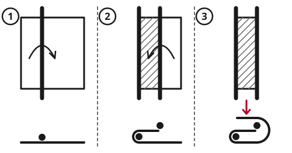

> [!CAUTION]
> **Do not move an injured person unless staying is more dangerous.** Moving can restart bleeding and worsen broken bones and spine injuries. If the place is safe, treat them there and bring help.
>
> **Do not become a second casualty.** A rescuer who hurts their back or falls cannot help anyone. Get helpers.
>
> **Never twist the body or pull the head sideways.** Move along the length of the body, keeping the head, neck and body in a line.

## Quick steps

1. **Decide if you must move them.** Move only if staying is more dangerous: fire, smoke, gas, collapse, rising water, traffic, cold, or no rescue coming.
2. **Treat first if there is time:** stop heavy bleeding, open the airway, splint broken bones.
3. **Get helpers.** One person leads and gives every command.
4. **In a hurry, drag them** by the clothes at the shoulders, head first, in a straight line.
5. **For longer distances, use a stretcher.** Test it with a healthy person first.
6. **Lift together on a count,** with straight backs and bent knees.
7. **Check the person every 15 minutes:** breathing, bleeding, warmth, straps.

## Should you move them?

**Move them at once if:** there is fire, smoke or gas; the building may collapse; water is rising; there is traffic; or they need care you cannot give where they lie, such as CPR on a firm surface.

**Move them soon if:** they are getting cold, wet or overheated, or no help can come.

**Otherwise, stay.** Treat them, shelter them, and signal for help. See [Signaling for Rescue](../navigation/signal-rescue.md).

If the neck or back may be injured, see [Head, Neck and Back Injuries](../medical/head-spine-injury.md) first. If there is time, splint broken bones: see [Broken Bones, Sprains and Dislocations](../medical/fractures-sprains.md).

## Emergency drags

Drags move someone a short way, fast, by one person.

- **Clothes drag:** crouch behind the head. Grip the clothes at both shoulders, not at the neck. Rest their head on your forearms. Walk backward, pulling them head first in a straight line.
- **Blanket drag:** roll a blanket, tarp, rug or coat lengthwise against their side. Roll them onto their side, push the rolled part under them, roll them back and pull it out the other side. Gather the blanket at the head and pull.
- **Under-arm drag:** for someone slumped in a seat or car. From behind, reach under both armpits, grip one of their forearms across their chest with both hands, and pull them back against you. Walk backward.

## Carries by one person

- **Supporting walk:** for someone who can walk a little. Stand at their injured side, unless that arm is hurt. Put their arm around your neck and hold the wrist. Put your other arm around their waist.
- **Pack-strap carry:** turn your back to them. Pull their arms over your shoulders and cross them over your chest. Hold their wrists, lean forward and lift them onto your back.
- **Piggyback or cradle carry:** for children and light adults who can hold on.

> [!WARNING]
> The fireman's carry (over your shoulders) is hard to get into, needs a strong carrier, hangs the head down and presses on the belly. It often injures the carrier. Use it only if nothing else works, and never with injuries to the head, neck, back, chest or belly.

## Carries by two people

- **Four-handed seat:** for someone who can hold on with their arms. Each carrier grips their own left wrist with their right hand, then grips the other carrier's right wrist with their free left hand, making a square seat. They sit on it with an arm around each carrier's shoulders.
- **Two-handed seat:** for someone who cannot hold on. Squat on each side. Cross your arms behind their back and grip their clothing. Hook your other hands together under their thighs, with a cloth pad between them. Stand up together.
- **Chair carry:** for stairs and narrow halls. Sit them in a strong chair without wheels and tie them in. One carrier holds the chair back from behind and tilts it back a little. The other faces forward and holds the front legs.

Never use these seats for spine, pelvis or thigh injuries. Carry them flat.

## Improvised stretchers

Use strong, straight poles, pipes or branches about 2.2-2.5 m (7-8 ft) long, so they stick out at both ends as handles.

### Blanket and 2 poles

The person's weight presses the layers together, so the blanket cannot slip off the poles.

```
  Blanket seen from above. The poles lie
  along lines A and B.

  +-----------+-----------+-----------+
  |           |           |           |
  |  part 1   |  part 2   |  part 3   |
  |           |           |           |
  |           |           |           |
  +-----------+-----------+-----------+
              A           B
```

1. Lay the blanket flat. Lay pole A on line A, one third of the way across.
2. Fold part 1 over pole A, onto part 2.
3. Lay pole B on line B, on top of the folded edge.
4. Fold part 3 over pole B, onto part 2. The person lies on this side.



A blanket 1.5-1.8 m (5-6 ft) wide puts the poles about 50-60 cm (20-24 in) apart. A plastic tarp is slippery: roll each edge around a pole several times and tie it.

### Other stretchers

- **Jackets:** close 2 or 3 strong jackets, turn them inside out so the sleeves are inside, and push a pole through each sleeve.
- **Sacks:** cut a hole in both bottom corners of 2 or 3 strong grain sacks and push the poles through.
- **Rigid:** a door, board, ladder or table top, well padded. Knock the pins out of the hinges to take a door off.

### Test it first

Before use, have a healthy person at least as heavy as the patient lie on it. Lift it 30 cm (1 ft), hold it, and bounce it gently. Check that nothing bends, cracks, slips or tears.

## Lifting and carrying a stretcher

1. **One leader,** at the head, gives every command: "Ready to lift. Lift on 3. 1, 2, 3, lift."
2. **Lift with your legs.** Bend your knees, keep your back straight and the load close.
3. **Put the strongest carriers at the head end.** It is the heavier end.
4. **On flat ground, carry feet first.** The carrier at the head can then watch the face.
5. **On slopes and stairs, keep the head uphill.** Go up head first and down feet first. Keep the stretcher level by raising the downhill end.
6. **Do not walk in step.** Marching in step makes the stretcher swing.
7. **At walls, ditches and fallen trees,** put the stretcher down and pass it across hand to hand. Never jump with it. On steep or slippery ground, pass it along a line of helpers.

## Long carries

- **People:** 4 carry at a time. Have at least 6-8, so carriers can swap often. Over rough ground for many hours, rescue teams use 12 or more.
- **Swap one carrier at a time** while walking, before anyone is exhausted. Rest, drink and eat often.
- **Speed:** expect about 1-2 km (0.5-1 mile) per hour on a path, and often less than 1 km (0.5 mile) per hour over rough ground. Send a scout ahead: a longer, smoother route is often faster.
- **Keep them warm:** put insulation under them as well as over them, and a plastic sheet over everything in rain. Keep the face uncovered. See [Hypothermia and Frostbite](../medical/hypothermia-frostbite.md).
- **Pad them:** behind the knees, under the head, and at heels, hips and elbows.
- **Tie them in** with straps across the chest, hips, thighs and below the knees. Do not tie over wounds. You should be able to slide a flat hand under each strap. If they vomit, tip the whole stretcher onto its side at once.
- **Check every 15 minutes:** breathing, response, bleeding, warmth, color and feeling of the fingers and toes, and the straps.

## Carrying someone for days

- **Send 2 fit people ahead** with a written note: the place, the injuries, and what you need.
- **Water and food:** if they are fully awake, can swallow and are not vomiting, give sips often and small meals. With a belly injury, see [Chest and Belly Injuries](../medical/chest-injuries.md).
- **Toilet:** offer it every few hours. Use a bottle for urine, or a shallow pan or a plastic bag in a container. Give privacy. Clean and dry the skin afterward.
- **Pressure sores:** a hard stretcher can cause skin damage within hours. Shift their weight or turn them at least every 2 hours. Check the skin over the tailbone, hips, heels, shoulder blades and back of the head daily. Press a red patch with a finger: if it does not turn pale, a sore is starting. Keep all weight off it.
- **Write down** vital signs with the times. Talk to the person: fear and loneliness make everything worse.

A cart, wheelbarrow, sled on snow or a boat can save a lot of effort. Pad it and tie the person in.

## Sources

- US Federal Emergency Management Agency (FEMA), *CERT Basic Training Participant Manual*, 2019.
- US Army, *FM 4-25.11 First Aid*, 2002 (public domain).
- International Federation of Red Cross and Red Crescent Societies (IFRC), *International First Aid, Resuscitation, and Education Guidelines 2020*, 2020.
- European Pressure Ulcer Advisory Panel, National Pressure Injury Advisory Panel and Pan Pacific Pressure Injury Alliance, *Prevention and Treatment of Pressure Ulcers/Injuries: Clinical Practice Guideline*, 2019.
