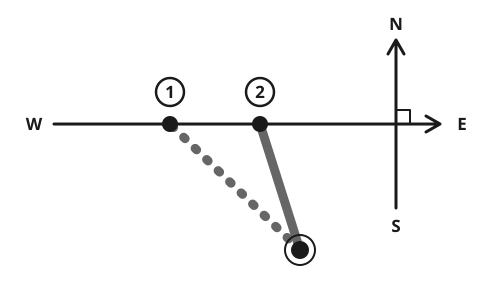

> [!CAUTION]
> **If you are lost and someone will search for you, staying put is usually safer than walking.** See [What to Do When You Are Lost](../navigation/lost.md).
>
> **Sun, watch and star methods are rough.** They can be 10 to 30 degrees wrong. Over a long walk that puts you kilometers off target. Aim for a large feature you cannot miss, such as a road, river or coast.
>
> **Moss, tree branches and anthills do not show north.** Trusting these myths gets people more lost.

## Quick steps

1. **Decide whether to move at all.** If you do, move in daylight.
2. **Find a rough direction** from the sun: it rises roughly in the east and sets roughly in the west.
3. **Check it with a shadow stick** (15 to 30 minutes) or the watch method.
4. **Pick a distant landmark** in your chosen direction, walk to it, then pick the next one.
5. **Count your steps** to know how far you have gone.
6. **Head for a long feature** across your path: a road, river, power line or coast.

## The sun

- The sun rises roughly **east** and sets roughly **west**, everywhere on Earth.
- It is exactly east and west only around **20 March and 22 September.** From March to September, it rises and sets north of east and west. From September to March, south of east and west. At middle latitudes the difference can reach 30 degrees or more.
- **At midday,** when shadows are shortest, the sun is due **south** if you are in the northern half of the world, and due **north** in the southern half. In the tropics the midday sun is nearly overhead, so this does not work well.
- Midday by the sun is often not 12:00 on the clock. It can differ by an hour or more because of time zones and summer (daylight saving) time.

## Shadow-stick method

This works anywhere the sun casts a shadow, in both hemispheres.

1. Push a straight stick about **1 m (3 ft)** long upright into flat, clear ground.
2. Put a small stone at the tip of its shadow.
3. Wait **15 to 30 minutes.** Put a second stone at the new shadow tip.
4. The line from the first stone to the second runs roughly **west to east.**
5. Stand with the first stone on your left and the second on your right. You are facing roughly **north.**



It is most accurate near midday. For a better result, mark the shadow tip in the morning, draw a circle around the stick through that mark, and mark where the shadow tip touches the circle again in the afternoon. That line runs almost exactly west to east.

## Watch method

You need a watch with hands, or draw a clock face on paper or the ground with the correct time.

**Northern hemisphere:**

1. Hold the watch flat. Point the **hour hand** at the sun.
2. **South** lies halfway between the hour hand and the **12**, in the smaller angle.

**Southern hemisphere:**

1. Hold the watch flat. Point the **12** at the sun.
2. **North** lies halfway between the 12 and the **hour hand**, in the smaller angle.

**During summer (daylight saving) time,** use the 1 instead of the 12.

This method is rough, and poor in the tropics. Check it with a shadow stick.

## Stars

### North Star (northern hemisphere)

The North Star (Polaris) sits within 1 degree of true north. It is **not** the brightest star; it is of medium brightness and stands fairly alone. Its height above the horizon is about equal to your latitude.

1. **Find the Big Dipper (the Plough):** 7 bright stars shaped like a pan with a handle.
2. Take the 2 stars at the **front edge of the pan,** away from the handle. These are the pointer stars.
3. Follow the line from the bottom pointer through the top pointer for about **5 times the gap between them.** The star you reach is the North Star.
4. If the Big Dipper is low or hidden, find **Cassiopeia,** a W or M shape of 5 stars on the opposite side of the North Star. The North Star lies roughly between the 2 groups.
5. Drop a straight line from the North Star to the horizon. That point is **north.**


```
                      *   North Star
                      .
                      .   about 5 times
                      .   the pointer gap
                      .
  *---*---*---*-------*   pointer star
              |       |
              *-------*   pointer star
  handle        pan
```
### Southern Cross (southern hemisphere)

1. **Find the Southern Cross (Crux):** 4 bright stars in a small kite shape. Nearby are 2 very bright **pointer stars.**
2. Draw an imaginary line along the long axis of the cross, from the top star through the bottom star.
3. Extend it about **4.5 times** the length of the cross. This point is the south celestial pole; no bright star marks it.
4. To check: draw a line between the 2 pointer stars, and from its middle draw a line at a right angle. Where it meets your first line is the same point.
5. Drop straight down from that point to the horizon. That point is **south.**


Do not confuse it with the **False Cross,** which is larger, dimmer, and has no pointer stars nearby.

### Orion's Belt (both hemispheres)

Orion's Belt is 3 bright stars in a short straight row. It **rises almost due east and sets almost due west,** everywhere on Earth. It is easiest to see in the evening from about December to March.

## The moon

- The moon also rises roughly in the east and sets roughly in the west.
- Its lit side faces the sun. In the evening, the lit side faces roughly west. Use the moon only as a rough check.

## Map and compass

- The colored end of a compass needle (usually red) points to **magnetic north.**
- **Hold it flat,** a few steps from vehicles and fences, and away from knives, phones, magnets and power lines.
- **Magnetic declination** is the difference between magnetic north and true north. It depends on where you are, changes slowly over the years, and is usually printed on maps. Each degree of error puts you about **17 m off for every 1 km** (90 ft per mile) you walk.

**To follow a direction from a map with a baseplate compass:**

1. Lay the compass edge on the map along the line from where you are to where you want to go, with the direction-of-travel arrow pointing toward your goal.
2. Turn the dial until its north-south lines run parallel with the map's north-south lines, with N toward the top of the map.
3. Adjust for declination if you know it.
4. Hold the compass flat in front of you, travel arrow pointing ahead. Turn your body until the red needle sits inside the outline arrow on the dial.
5. Walk where the travel arrow points. Pick a landmark on that line and walk to it.

**Improvised compass:** stroke a sewing needle 30 to 50 times in one direction with a magnet. Float it on a leaf in still water. It turns to lie north-south. Check which end is north with the sun.

## Measuring distance by pacing

- **Count every time your left foot touches the ground.** That is one pace (2 steps).
- An average adult takes about **65 paces per 100 m** (330 ft) on flat ground. Yours may differ.
- **Calibrate:** walk a known 100 m 3 times, count, and use the average.
- **Count more** uphill, on rough ground, in snow or sand, when carrying a load, when tired, and at night.
- **Keep track:** tie a knot in a cord, or move a pebble from one pocket to another, every 100 m.
- **Time is a rough guide too:** on a good path, adults walk about 4 to 5 km (2.5 to 3 miles) per hour. Add about 1 hour for every 600 m (2,000 ft) you climb.

## Staying on course

- **Use landmarks.** People walking with no landmark, in fog, forest or darkness, curve without knowing it and can walk in circles.
- **Handrails:** follow long features that run your way, such as a river, ridge, valley, fence, road or power line.
- **Catching features:** know which large feature lies beyond your goal, so you know when you have gone too far.
- **Aim off:** to reach a bridge on a river, aim deliberately to one side of it. When you reach the river, you know which way to turn.
- In towns, satellite TV dishes in many regions point roughly toward the equator. Use this only as a rough clue.

## Myths

- **"Moss grows on the north side of trees."** Moss grows wherever it is damp and shaded, on any side.
- **"The North Star is the brightest star."** It is not. Many stars are brighter.
- **"The sun is due south at 12:00."** Only roughly, and only north of the tropics.
- **"You can feel which way you are walking."** You cannot. Without landmarks, everyone drifts.

For signaling, see [Signaling for Rescue](../navigation/signal-rescue.md). For measuring without tools, see [Measuring Without Tools](../reference/measurements.md).

## Sources

- US Army, *ATP 3-50.21 Survival*, 2018 (public domain).
- US Army, *TC 3-25.26 Map Reading and Land Navigation*, 2013 (public domain).
- Souman J. L. et al., "Walking straight into circles", *Current Biology*, 2009.
- US National Oceanic and Atmospheric Administration (NOAA) and British Geological Survey, *World Magnetic Model 2025*, 2024.
