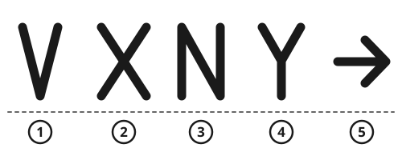

> [!CAUTION]
> **Stay with your vehicle, boat or aircraft wreck** unless it is on fire, flooding or otherwise unsafe. It is far easier to see from the air than a person.
>
> **Prepare your signals now, before you hear an aircraft.** A plane passes in seconds. A fire you still have to build, or a mirror at the bottom of a bag, is useless.
>
> **Do not start a wildfire.** In dry grass or forest, clear the ground to bare soil around every fire and keep it small until you need it. A wildfire can kill you and your rescuers.

## Quick steps

1. **Stay in one place,** in or next to the most open area nearby: a clearing, ridge, beach, riverbank or snowfield.
2. **Call or text for help** if you have a phone: try 112, 911, 999 or your local emergency number. If calls fail, send a text with your location.
3. **Turn on a personal locator beacon** if you have one, with the antenna upright and a clear view of the sky.
4. **Signal in threes:** 3 whistle blasts, 3 fires, 3 flashes. Pause, then repeat.
5. **Make a large ground signal:** a **V** (we need help) or **X** (we need medical help), at least **3 m (10 ft)** long, in a color that contrasts with the ground.
6. **Get 3 fires ready to light,** with green leaves nearby for smoke.
7. **Flash a mirror** at every aircraft, boat or distant person you see.

## The rule of three

Any signal repeated 3 times means "help" almost everywhere in the world.

- **Sound:** 3 blasts on a whistle, 3 blasts of a car horn, or 3 loud bangs on metal. Pause for about 1 minute, then repeat.
- **Light:** 3 flashes of a flashlight or a mirror.
- **Fire:** 3 fires in a triangle or in a straight line, about **25 m (80 ft)** apart.

A whistle carries much farther than your voice and uses far less energy. Keep one on a cord around your neck.

> [!NOTE]
> In European mountains, the **Alpine distress signal** is also used: 6 blasts or flashes spread over 1 minute, then 1 minute of silence, then repeat. The answer is 3 blasts or flashes per minute.

## SOS

SOS is 3 short, 3 long, 3 short signals, sent as one group with no gap between the letters:

```
  . . .   - - -   . . .
  short   long    short
```

- **Short:** about 1 second. **Long:** about 3 seconds. Pause 1 second between signals.
- After each SOS, pause for about 7 seconds, then repeat.
- Send it with a flashlight, a phone light, a car's headlights, a whistle or a horn.
- You can also write **SOS** or **HELP** on the ground in large letters.

For other codes, see [Morse Code and Signal Codes](../comms/morse-code.md).

## Signal mirror

On a sunny day, a mirror flash can be seen tens of kilometers away. It is one of the best signals there is.

**Use any shiny object:** a signal mirror, a car mirror, a CD or DVD, a phone screen, a polished can lid, or foil smoothed flat over cardboard.

### Aiming with a sighting mirror (or a CD)

1. Hold the mirror close to one eye and look at the target through the center hole.
2. Look for a bright spot of reflected sunlight, either through the hole or on your other hand held out in front.
3. Tilt the mirror slowly until the bright spot sits on the target.
4. Rock the mirror gently so the flash passes back and forth across the target.

### Aiming any mirror with 2 fingers

1. Stretch one arm out toward the target. Make a V with 2 fingers, with the target between them.
2. With your other hand, hold the mirror just below your eye.
3. Tilt the mirror until the spot of reflected sunlight lands on your fingers.
4. Move the spot up into the V and across the target, then back down. Repeat.


- **Sweep the horizon** with flashes every few minutes, even when you see nothing. Pilots may see you before you see or hear them.
- **Once the aircraft clearly answers** (rocking its wings or turning toward you), stop flashing directly into the cockpit. A bright flash can blind the pilot for a moment.
- Mirrors work only with the sun in the sky. At night, use a flashlight instead.

## Ground-to-air signals

These international symbols are understood by rescue crews worldwide:

| Symbol | Meaning |
|---|---|
| V | We need help |
| X | We need medical help |
| N | No |
| Y | Yes |
| Arrow | We have gone this way |



How to make them:

- **Big:** each symbol at least **3 m (10 ft)** long. Bigger is better: 6 m (20 ft) or more if you can. Make the lines about 1 m (3 ft) wide.
- **High contrast:** dark on light, light on dark. On snow, use branches, or stamp deep trenches that make shadows. On dark ground or grass, use pale rocks, clothing, a tarp, foil, or a life jacket.
- **Straight lines and sharp angles.** Nature has few straight lines, so they catch a pilot's eye.
- **In the open:** clearings, beaches, gravel bars, snowfields, flat rooftops. Not under trees.
- If you leave, make an arrow pointing the way you went.

### Body signals

If an aircraft is close, many rescue crews understand these:

- **Both arms raised above your head in a Y:** "Yes, we need help."
- **One arm raised, the other down at your side:** "No, we do not need help."

**Aircraft replies:** by day, a pilot rocks the wings to show the message is understood. At night, a pilot may flash the aircraft's lights on and off twice.

## Fire and smoke

Fire is the best signal at night. Smoke is best by day.

### Preparing signal fires

1. Choose an open spot, in view of the sky.
2. Clear the ground to bare soil for 3 m (10 ft) around each fire.
3. Build each fire ready to light: dry tinder at the bottom, then small sticks, then larger wood.
4. Keep the tinder dry under bark, plastic or a stone. Remove the cover when you light it.
5. Keep one small fire burning so you can light the others in seconds. See [Making and Keeping a Fire](../fire/make-fire.md).

### Making smoke

- **White smoke** shows best against dark forest and earth. Add green leaves, fresh green branches, moss or damp grass to a hot fire.
- **Black smoke** shows best against snow, sand and pale sky. Add rubber, oil or plastic, such as pieces of tire, rubber mats or engine oil. Stand upwind: the smoke is poisonous.
- Smoke rises highest in calm air. Wind, rain and snow flatten and scatter it.
- Pile smoke materials next to the fire and add them when you hear an aircraft.

## Phones

- **Call your emergency number:** 112 works in Europe and in many other countries, and many phones connect it to the local number. Others include 911 (the Americas), 999 (UK and others) and 000 (Australia).
- **Emergency calls can use any network,** not only yours. If your phone shows "Emergency calls only" or "SOS", you can still call. In many countries this also works without a SIM card.
- **Text when calls fail.** A text needs less signal and keeps trying to send. In some places you can text the emergency number; if not, text a trusted person.
- **Send your location.** A map or compass app shows your coordinates even without mobile signal. Many phones also send your location automatically when you call the emergency number.
- **Some recent phones can send emergency messages by satellite** when there is no mobile signal. You need a clear view of the sky.
- **Save the battery:** turn on airplane mode between attempts. Try again from high ground, at set times. See [Batteries: Use, Charge and Stay Safe](../power/batteries.md).

**Say or write:** who you are, where you are (coordinates or landmarks), what happened, how many people, injuries, and what you need.

## Personal locator beacons (PLBs)

A PLB sends a distress signal on **406 MHz** to search and rescue satellites, usually with your GPS position. It also sends a weaker **121.5 MHz** signal that rescuers use to home in on you.

1. Use it only in real danger to life.
2. Extend the antenna and hold it upright, with a clear view of the sky. Do not cover it with your body.
3. **Leave it on.** Do not switch it off to save the battery once rescue seems slow. Most PLBs transmit for at least 24 hours.
4. Stay where you are, if you safely can.

Satellite messengers work in a similar way. In normal times, register your beacon in your country. Many aircraft carry a beacon that turns on by itself in a crash: another reason to stay near the wreck.

## Being visible from the air

- From the air, a person under trees is almost invisible. Wait in the nearest safe open space.
- **Spread out bright colors:** orange, red, yellow, or anything that contrasts with the ground. Lay out tents, tarps, clothes and foil blankets flat in the open.
- **Movement catches the eye.** Wave a large, bright cloth in wide, slow arcs.
- **At night,** flash a light toward any aircraft sound, or swing a light stick on a 1 m (3 ft) cord in a circle. Many rescue aircraft use heat cameras, so a fire in the open helps.
- **Helicopter crews cannot hear you shout.** Use visual signals.

### Staying with a vehicle, boat or wreck

- It gives shelter and is a large target that rescuers look for first.
- Raise the hood (bonnet) and tie bright cloth to the antenna or mirror.
- Use mirrors, lights and horn, but save enough battery to start the engine.
- **Never run the engine with the exhaust blocked by snow.** It fills the car with carbon monoxide.
- Leave only if it is unsafe, nobody knows you are there, or help is close and you know exactly how to reach it. If you go, leave a note with the time, your direction and your plan, and mark your path. See [What to Do When You Are Lost](../navigation/lost.md).

## Sources

- International Civil Aviation Organization (ICAO), *Annex 12 to the Convention on International Civil Aviation: Search and Rescue*, 8th edition, 2004.
- International Maritime Organization and ICAO, *IAMSAR Manual, Volume III: Mobile Facilities*, 2022 edition.
- US Army, *ATP 3-50.21 Survival*, 2018 (public domain).
- US National Oceanic and Atmospheric Administration (NOAA), *Search and Rescue Satellite Aided Tracking (SARSAT)*: beacon information, 2024.
- European Commission, *112: the European Emergency Number*, 2024.
- US Federal Communications Commission (FCC), *Text to 911: What You Need to Know*, 2024.
