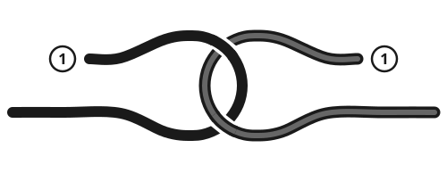

> [!CAUTION]
> **Never use a square (reef) knot to join 2 ropes that will hold a load or a person.** It can slip or pull apart. Use a sheet bend.
>
> **Do not trust unknown rope, or a knot you are unsure of, with a person's weight.** Every knot weakens rope, often by a third or more. Test each knot with a hard pull and have a second person check it.
>
> **Never wrap rope around your hand or fingers** when holding a load. A sudden pull can crush or cut them. Stand clear of ropes under high tension: they whip back when they break.

## Words used here

- **Working end:** the end you move to tie the knot.
- **Standing part:** the long rest of the rope.
- **Bight:** a U-shaped fold in the rope.
- **Loop:** a circle made where the rope crosses itself.
- **Tail:** the short end left after tying. Leave at least 10 cm (4 in).

## Which knot to use

| Job | Knot |
|---|---|
| Tie a bandage or bundle | Square (reef) knot |
| Fixed loop that will not slip | Bowline, figure-eight loop |
| Tie to a post or start a lashing | Clove hitch |
| Tie a line to a tree or ring | Two half hitches |
| Adjustable tent or tarp line | Taut-line hitch |
| Pull a line very tight | Trucker's hitch |
| Join 2 ropes, even of different sizes | Sheet bend |
| Stop rope sliding through a hole | Figure-eight knot |
| Grip a rope to climb or hold it | Prusik |

## Square (reef) knot

For bandages, slings, bundles and bags. Not for loads.

1. Hold one end in each hand.
2. Pass the right end over the left end, then under it.
3. Pass the end now in your left hand over the other end, then under it.
4. Pull both ends to tighten.
5. Check: both ends lie flat beside their own rope, on the same side. If they stick out crosswise, it is a granny knot, which slips. Untie it and tie again.



Remember: **right over left, then left over right.**

## Bowline

A loop that does not slip or tighten and is easy to untie after a load. Use it around a tree, a post, or a person's chest (under the arms) for a rescue.

1. Make a small loop in the standing part, with the working-end side crossing **on top**.
2. Pass the working end **up** through the small loop from underneath.
3. Take it **around behind** the standing part.
4. Pass it back **down** through the small loop.
5. Hold the working end against the side of the big loop and pull the standing part hard.


A bowline can shake loose when it is not under load, especially in stiff or slippery rope. Tie an overhand knot with the tail around the side of the loop to lock it.

## Clove hitch

Quick to tie to a post and easy to adjust. Used to start lashings.

1. Pass the working end around the post.
2. Cross it over the standing part, making an X.
3. Pass it around the post again, next to the first turn.
4. Tuck the end under the last turn, so it comes out under the X, in the opposite direction to the standing part.
5. Pull both ends tight.


A clove hitch can slip if the pull changes direction or the post turns. For anything important, add 2 half hitches.

## Two half hitches

Ties a line to a tree, post or ring.

1. Pass the working end around the post or through the ring.
2. Take the end over the standing part, then under it and back through the gap. This is one half hitch.
3. Make a second half hitch the same way, a little farther along the standing part.
4. Slide both hitches up tight against the post.

For a heavy load, first wrap the rope twice around the post (a round turn), then add the 2 half hitches.

## Taut-line hitch

An adjustable loop for tent and tarp lines. It slides to tighten, then grips under tension.

1. Pass the working end around the stake, or through the tarp's loop, and bring it back beside the standing part.
2. Wrap the end **twice** around the standing part, working back toward the stake (inside the loop).
3. Bring the end across the outside of those wraps, and wrap it **once more** around the standing part, farther from the stake.
4. Tuck the end under this last wrap and pull it snug.
5. Slide the knot away from the stake to tighten the line, toward it to loosen.

## Trucker's hitch

Pulls a line very tight, for tarps, ridgelines and tying down loads.

1. Tie one end to the first anchor, for example with a bowline around a tree.
2. About two-thirds of the way to the second anchor, make a fixed loop in the rope. A figure-eight loop (below) is best.
3. Pass the free end around the second anchor (a tree, stake or ring).
4. Bring the free end back and pass it through the loop.
5. Pull the free end back toward the second anchor. The loop works like a pulley, so your pull is multiplied.
6. Pinch the rope at the loop to hold the tension, then tie off with 2 half hitches around both strands.

```
 tree                    loop                 stake
  O======================(o)--------------------O
                          ^                     |
                          |                     |
                          +----<-----<-----<----+
                                free end
     Free end: around the stake, back through
     the loop, then pull toward the stake.
```

## Sheet bend

Joins 2 ropes, even if one is thicker or stiffer.

1. Make a bight (a U) in the end of the thicker rope. Hold it.
2. Pass the end of the thinner rope **up** through the bight from underneath.
3. Wrap it around behind **both** sides of the bight.
4. Tuck it under itself, where it entered the bight. Do not pass it through the bight again.
5. Pull all 4 strands tight. Both short ends should be on the same side.

For very different sizes or slippery rope, wrap twice in step 3 (a double sheet bend).

## Figure-eight knot

A stopper knot. It stops a rope end slipping through a hole or your hand.

1. Make a loop near the end by passing the working end over the standing part.
2. Take the end around **behind** the standing part.
3. Pass the end down through the loop from the front.
4. Pull tight. It looks like the number 8.

## Figure-eight loop

A strong fixed loop. Hard to untie after a heavy load.

1. Fold the rope to make a bight about 30 cm (1 ft) long.
2. Hold the 2 strands together as if they were one rope.
3. Tie a figure-eight knot with the doubled rope (steps above).
4. Arrange the strands so they lie side by side without crossing. Pull each of the 4 strands tight.

To tie it around a tree or through a ring: tie a loose figure-eight in single rope, pass the end around the object, then feed it back through the knot along the first path.

## Prusik

A loop of thin cord wrapped around a thicker rope. It grips when pulled and slides when pushed by hand. Use it to climb a fixed rope, as a backup handhold, or as a sliding tie-point on a ridgeline.

1. Make a closed loop from about 1.2 m (4 ft) of cord that is clearly **thinner** than the main rope, about half to two-thirds of its thickness. Join the ends with a double fisherman's knot:
   - Lay the ends side by side, overlapping by 30 cm (1 ft).
   - Wrap one end twice around both strands, then pass it back through the 2 wraps and pull tight.
   - Do the same with the other end, in the opposite direction. Pull the 2 knots together.
2. Lay the loop behind the main rope.
3. Pass one end of the loop around the main rope and through the other end of the loop. Do this **3 times**, keeping the wraps neat and side by side.
4. Pull the hanging loop to tighten. Test it with your full weight close to the ground before you rely on it.

A prusik can slip on wet, icy or very thin rope. Add a wrap if it slips.

## Rope care and safety

- **Keep rope clean, dry and out of sunlight.** Do not step on it: grit cuts the fibers. Natural fiber rope rots if stored wet; sunlight weakens nylon. To make cord from plant fibers, see [Clay, Lime, Salt and Fiber: Materials From Nature](../land/natural-materials.md).
- **Keep it away from fuel, battery acid and chemicals.** Acid can destroy nylon without visible damage.
- **Pad sharp edges** with cloth or a branch where rope runs over rock or metal.
- **Stop ends fraying:** melt nylon or polyester ends with a flame; wrap natural rope ends with thread or tape.
- **Inspect before use.** Do not trust rope with cuts, melted or shiny spots, or parts that feel stiff, soft or thin.

Use these knots for [Building an Emergency Shelter](../shelter/emergency-shelter.md) and [Catching Fish](../food/fishing.md).

## Sources

- US Army, *FM 3-97.61 Military Mountaineering*, 2002 (public domain).
- US Army, *ATP 3-50.21 Survival*, 2018 (public domain).
- Ashley C. W., *The Ashley Book of Knots*, 1944.
